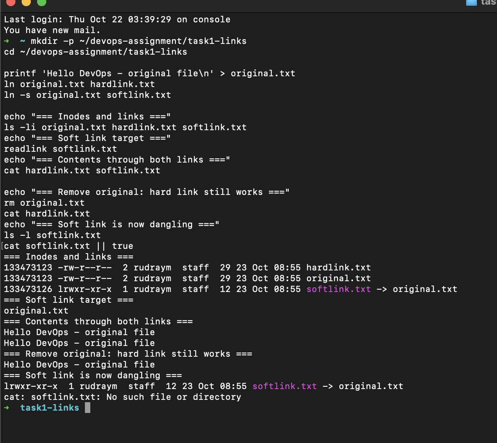
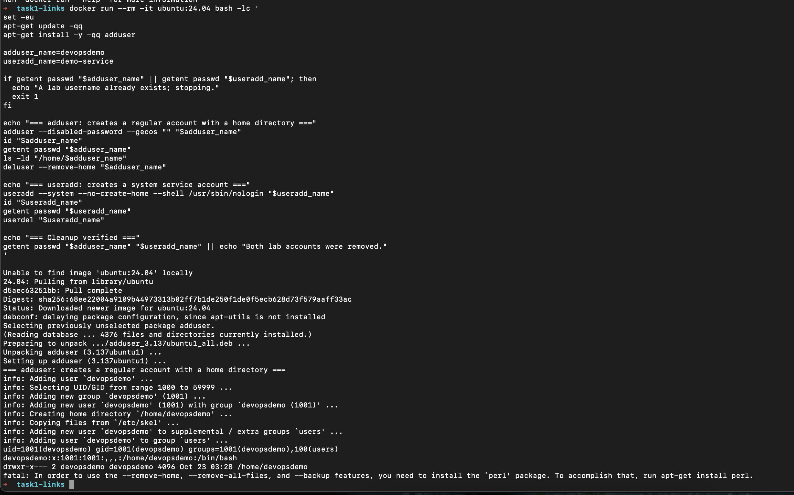
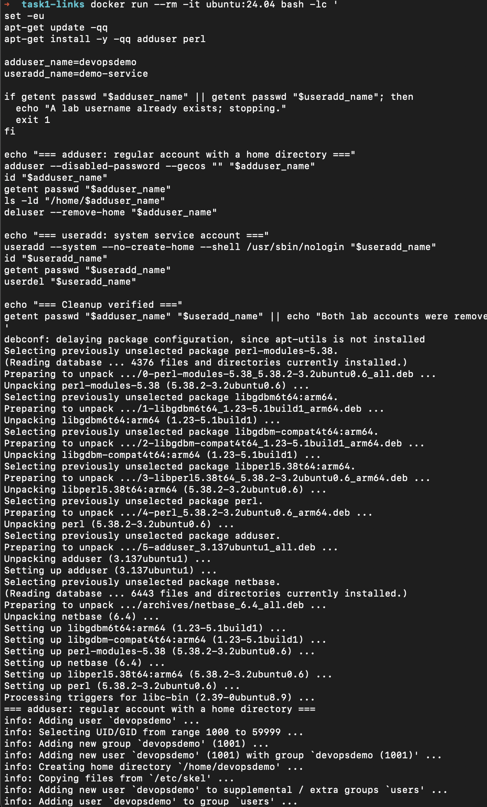
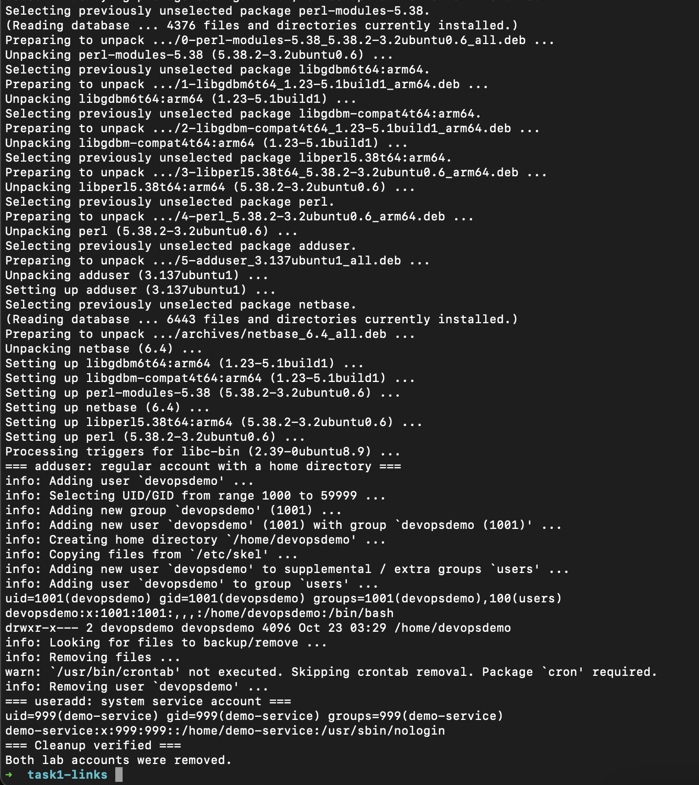
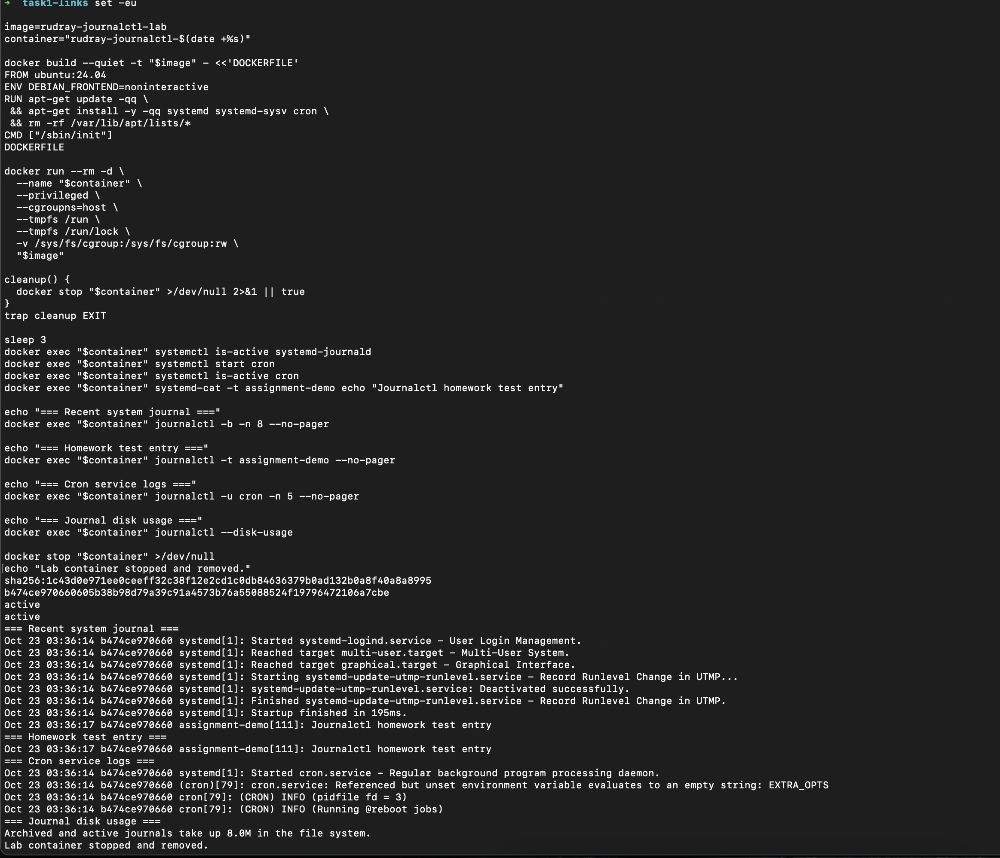
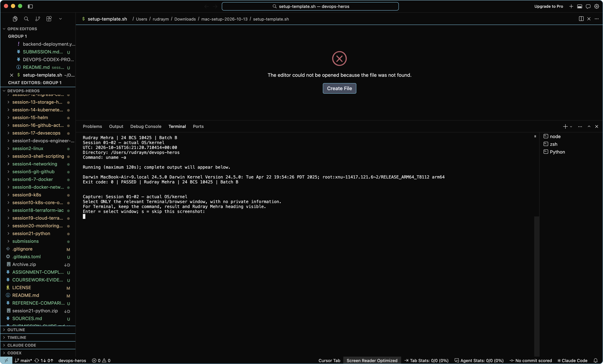
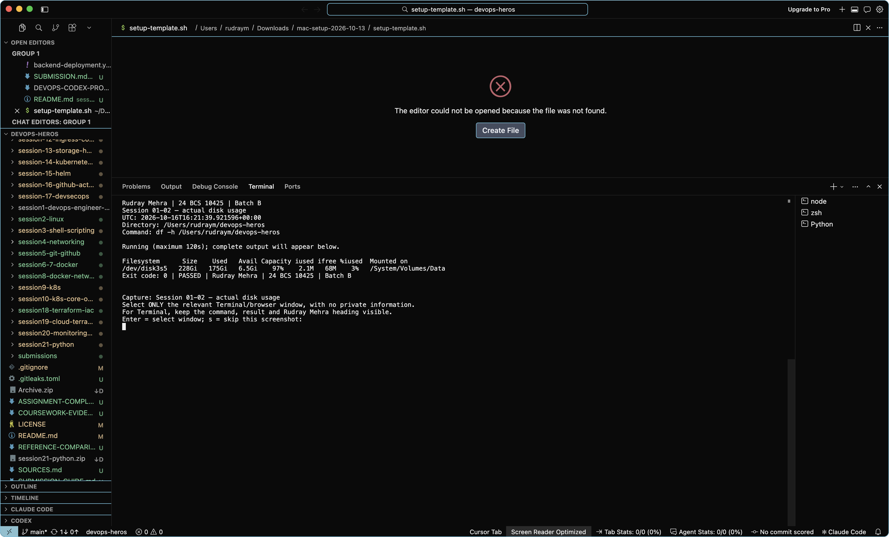

# Session 01-02 — evidence and screenshots

Rudray Mehra | 24 BCS 10425 | Batch B

Reference: Vivek's supplied ZIP. Filenames below are an audit inventory, not imported images.
No reference screenshot has been relabelled. A command log is not a native screenshot.

Required entry point/core-file checks: all listed files present (not a runtime pass).
Reference images: 8. Native captures: 9 accepted; 0 awaiting review; 0 rejected.

## Fresh execution records

### [rudray-20261023-085600](rudray-20261023-085600/README.md)

- Task 1 hard/soft link demonstration: PASS on macOS. The hard link shares the
  original inode and remains readable after the original name is removed; the
  soft link becomes dangling as expected.

### [rudray-20261023-085851](rudray-20261023-085851/README.md)

- Task 2 user-management attempt: INCOMPLETE. `adduser` succeeded, but
  `deluser --remove-home` stopped because `perl` was not installed. With `set -e`,
  the `useradd` demonstration and cleanup checks did not run. This is recorded as
  a failed attempt, not as completed task evidence.

### [rudray-20261023-090351](rudray-20261023-090351/README.md)

- Task 2 user management: PASS in an Ubuntu 24.04 container. `adduser` created a
  regular account and home directory; `useradd` created a system account with the
  `nologin` shell; both accounts were removed and the lookup confirmed cleanup.

### [rudray-20261023-090745](rudray-20261023-090745/README.md)

- Task 3 journalctl: PASS in a systemd-enabled Ubuntu 24.04 container. Journald
  and cron were active, the test entry and cron logs appeared, and the lab
  container was stopped and removed.

### [rudray-20261023-090932](rudray-20261023-090932/README.md)

- Task 4 command practice: PASS in an Ubuntu 24.04 container. The transcript covers
  navigation, file and text commands, permissions, processes, storage, networking,
  and archives. The local HTTP request returned `200 OK`.

### [rudray-20261016-212856-656600](rudray-20261016-212856-656600/README.md)

- [Session 01-02 — real hard/symbolic links on this host](rudray-20261016-212856-656600/01-links.txt): PASS.
- [Session 01-02 — actual OS/kernel](rudray-20261016-212856-656600/02-host.txt): PASS.
- [Session 01-02 — actual disk usage](rudray-20261016-212856-656600/03-disk.txt): PASS.
- Linux user management and journalctl: NOT RUN: Requires Linux/systemd; no host users created.
- Reference-specific pending items: NOT RUN: Linux useradd/adduser and journalctl need a real Linux/systemd environment. macOS link tests are labelled macOS, not Linux VM results..

### [rudray-20261016-215104-093414](rudray-20261016-215104-093414/README.md)

- [Session 01-02 — real hard/symbolic links on this host](rudray-20261016-215104-093414/01-links.txt): PASS.
- [Session 01-02 — actual OS/kernel](rudray-20261016-215104-093414/02-host.txt): PASS.

Reviewed native capture: Actual uname output and Rudray heading visible; macOS host, not a Linux VM.

- [Session 01-02 — actual disk usage](rudray-20261016-215104-093414/03-disk.txt): PASS.

Reviewed native capture: Actual disk-usage output and Rudray heading visible.

- Linux user management and journalctl: NOT RUN: Requires Linux/systemd; no host users created.
- Reference-specific pending items: NOT RUN: Linux useradd/adduser and journalctl need a real Linux/systemd environment. macOS link tests are labelled macOS, not Linux VM results..

## Rendered record images (not native screenshots)

[View generated images of our actual logs/recorded CI metadata](rendered-log-views/README.md).
These are explicitly labelled renderings. They do not change native-capture counts or turn failures into passes.

## Existing historical evidence

- [Earlier GitHub Actions run](https://github.com/rudraymehra/devops-heros/actions/runs/38372002674)

Historical timestamps, identities and resource names remain unchanged. These links do not imply a current live deployment.

## Capture scope

All four tasks have fresh evidence. Task 1's link demonstration ran on macOS;
Tasks 2–4 ran in Ubuntu 24.04 containers. The failed first Task 2 attempt remains
preserved separately and is not counted as a task pass.

Use the [coursework capture guide](../../COURSEWORK-EVIDENCE.md). The helper displays Rudray Mehra around freshly executed commands.

## Reference image inventory (not copied)

- `screenshots/task1-soft-hard-links-01.png`
- `screenshots/task2-adduser-vs-useradd-01.png`
- `screenshots/task3-journalctl-01.png`
- `screenshots/task3-journalctl-02.png`
- `screenshots/task4-cheat-sheet-01.png`
- `screenshots/task4-cheat-sheet-02.png`
- `screenshots/task4-cheat-sheet-linux-vm-01.png`
- `screenshots/task4-cheat-sheet-linux-vm-02.png`

## Checked source files

- [session2.md](../session2.md)
- [Linux Networking Cheat Sheet.pdf](../Linux%20Networking%20Cheat%20Sheet.pdf)
