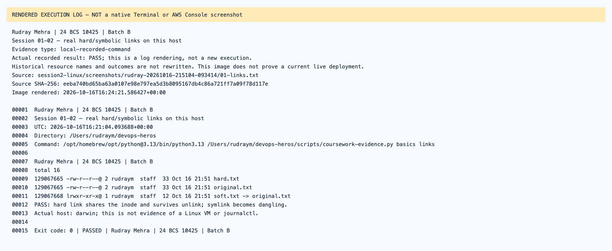
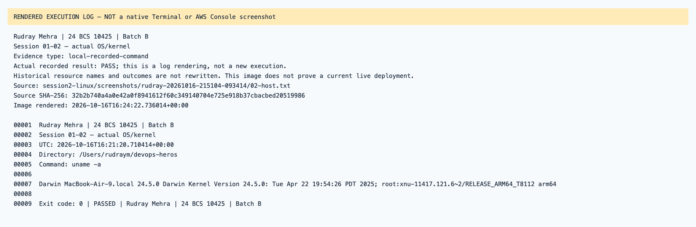
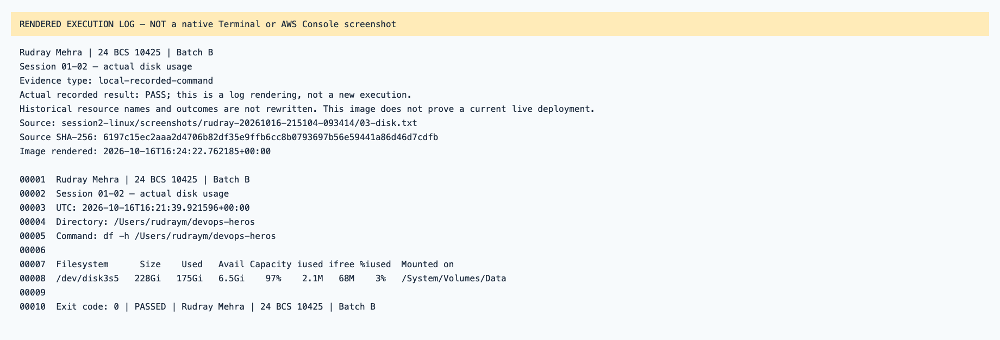

# Session 01-02 — rendered recorded evidence

Rudray Mehra · 24 BCS 10425 · Batch B

**Not native screenshots.** These PNGs render source-linked records. Historic resources are offline; failed attempts are not passes.
Current name in the heading identifies the submission. Old command/resource labels remain unchanged in excerpts.

## Session 01-02 — real hard/symbolic links on this host

Type: `local-recorded-command`.
[Original source](../rudray-20261016-215104-093414/01-links.txt) · [Rendered text](local-01-links.txt)

## Session 01-02 — actual OS/kernel

Type: `local-recorded-command`.
[Original source](../rudray-20261016-215104-093414/02-host.txt) · [Rendered text](local-02-host.txt)

## Session 01-02 — actual disk usage

Type: `local-recorded-command`.
[Original source](../rudray-20261016-215104-093414/03-disk.txt) · [Rendered text](local-03-disk.txt)

