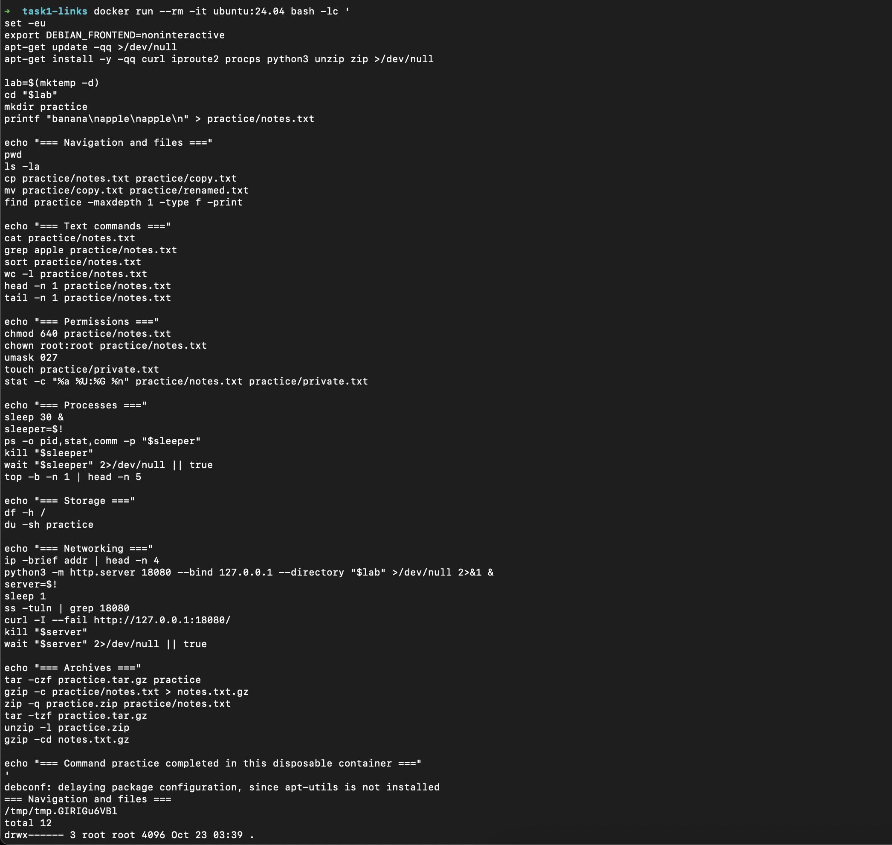
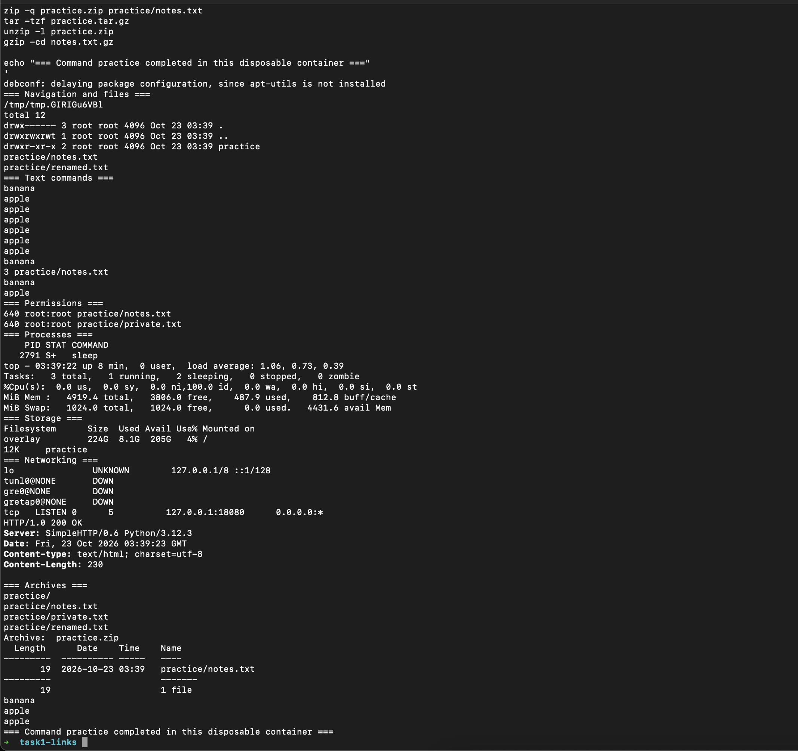

# Session 01–02 — Task 4 command practice

Rudray Mehra | 24 BCS 10425 | Batch B

Capture date: 2026-10-23, approximately 09:09 local time. Environment: Ubuntu
24.04 disposable container.

The run covers navigation, file management, text processing, permissions and
ownership, process inspection and termination, disk usage, IP/socket inspection,
a local HTTP request returning `200 OK`, and tar/gzip/zip archive commands. The
container was removed when the command exited.

