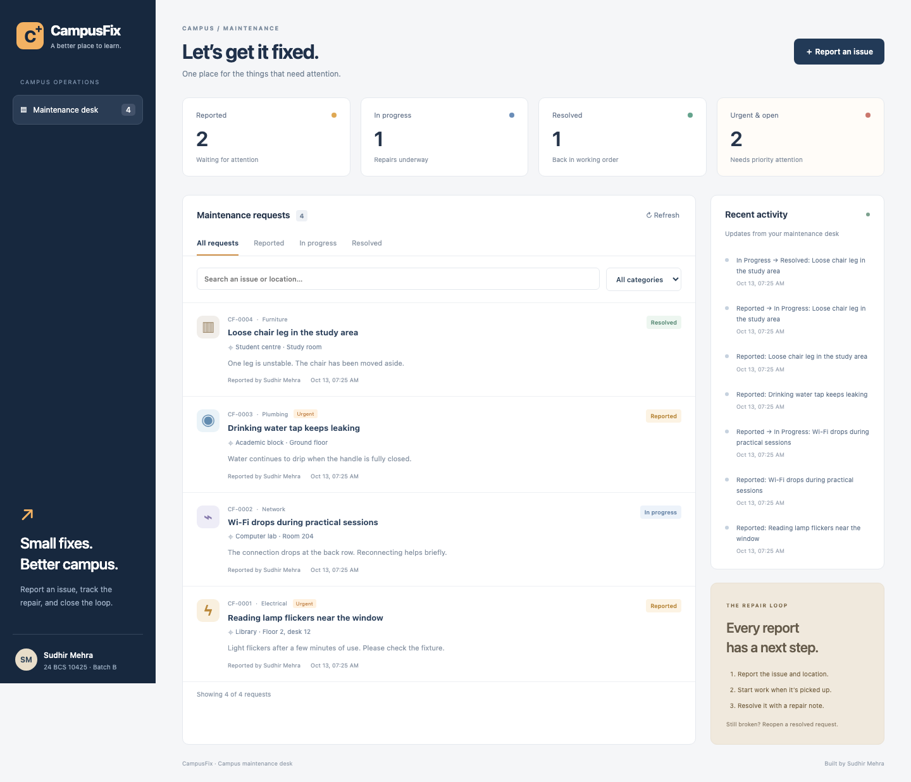
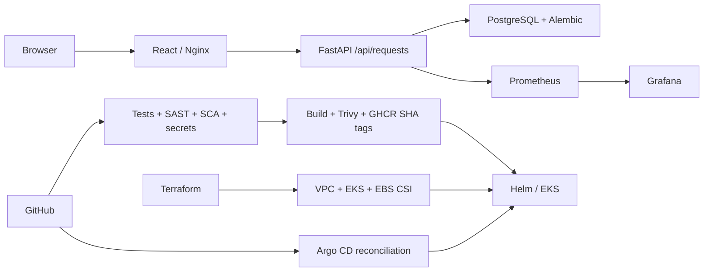

# CampusFix — campus maintenance desk

**Sudhir Mehra · 24 BCS 10425 · Batch B**
Email: rudray.24bcs10425@sst.scaler.com

CampusFix helps a campus team report broken facilities, locate the problem, track
repairs and record what was fixed. The application domain, interface, repair-state
rules and activity history extend the course's TaskBoard infrastructure scaffold.
The original license and source attribution are preserved in the repository.



## What is different from TaskBoard?

- Maintenance reports have a physical location, category, urgency and reporter.
- Repairs follow **Reported → In progress → Resolved**.
- Resolving a repair requires notes; reopening clears the old resolution.
- Every meaningful change creates a database-backed activity entry.
- Search matches issue titles and locations; category/status filters narrow the desk.
- Editing, deletion and failed-save handling work in the browser.
- The mobile layout is exercised at 390 px, with no horizontal page overflow.
- The API has 24 behavioural tests; PostgreSQL migrations are serialized to avoid
  races when two backend replicas start together.

The original `tasks` table is retained by migration 0001 for safe upgrades.
CampusFix uses the new `maintenance_requests` and `request_events` tables from
migration 0002. It does not reuse the old task CRUD API.

## Architecture



The Helm chart retains its internal name `taskboard` to avoid breaking existing
release names. The application and published images are named CampusFix.

## Run locally

From this directory:

```bash
docker compose -p campusfix up --build -d --wait
docker compose -p campusfix ps
curl --fail http://localhost:8000/ready
```

Open **http://localhost:3000**. API documentation: **http://localhost:8000/docs**.
PostgreSQL is internal to the Compose network, so an existing host database can
continue using port 5432. The web and API ports bind only to localhost.

```bash
docker compose -p campusfix down
```

This stops the lab and keeps its database volume. Use `down -v` only if you intend
to discard this lab's reports. Both application containers run as non-root users.

## Tests

Use Python 3.12 or 3.13; the pinned database driver does not support Python 3.14.

```bash
cd backend
python3.12 -m venv .venv
source .venv/bin/activate
pip install -r requirements-dev.txt
pytest -v
bandit -r app -ll
pip-audit -r requirements.txt
cd ../frontend
npm ci
npm audit --audit-level=high
npm run build
```

Tests use a fresh in-memory database with dependency overrides. They never clear
the running application's database. To exercise the real browser from the repo root:

```bash
python -m pip install playwright
python -m playwright install chromium
python session21-python/scripts/browser-check.py
```

The runner creates four clearly synthetic demonstration reports, runs the complete
repair workflow, verifies failed-save behaviour and saves desktop/mobile screenshots.
Its video is an automated application demo, not a narrated final presentation.

## Verified cloud run and submission status

The application ran on EKS with two frontend replicas, a persistent PostgreSQL
volume and 2–6 backend replicas. Under real HTTP load the HPA scaled to six;
30,291 requests completed with zero failures. Persistence, probe recovery,
Prometheus/Grafana and Argo CD self-healing were verified.

[Evidence index](evidence/README.md) ·
[Green CI run](https://github.com/rudraymehra/devops-heros/actions/runs/38342666849) ·
[Final cleanup audit](evidence/aws-cleanup-verification.md)

The paid lab is now destroyed; its endpoints are intentionally offline. The code,
images and recordings remain available. See the completion report for the student
presentation and screenshot-format requirements that still need review.

## API

| Method | Path | Purpose |
|---|---|---|
| GET | `/health` | Process liveness |
| GET | `/ready` | Database/schema readiness; 503 on failure |
| GET | `/metrics` | Prometheus metrics |
| GET / POST | `/api/requests` | Filter reports / create a report |
| GET / PUT / DELETE | `/api/requests/{id}` | Read, edit, advance or remove a report |
| GET | `/api/requests/stats` | Counts and urgent unresolved requests |
| GET | `/api/activity` | Persisted change history |

Categories: ELECTRICAL, PLUMBING, NETWORK, FURNITURE, OTHER. Urgency: NORMAL or URGENT.
Validation rejects blank required strings, unknown enum values and explicit null
updates. Invalid state transitions return 409; missing resolution notes return 422.

## Kubernetes and Helm

For the local lab, first build the images and load them into Minikube:

```bash
minikube start -p sudhir-devops --driver=docker --cpus=2 --memory=3072 --addons=ingress,metrics-server
minikube image load campusfix-backend:local campusfix-frontend:local -p sudhir-devops
helm upgrade --install taskboard helm/taskboard --kube-context sudhir-devops \
  -n taskboard --create-namespace -f helm/taskboard/values-dev.yaml \
  --set backend.image=campusfix-backend --set frontend.image=campusfix-frontend \
  --wait --timeout 5m
kubectl --context sudhir-devops get pods,svc,pvc,hpa,ingress -n taskboard
```

Two backend and two frontend replicas are configured. PostgreSQL uses a PVC and a
Recreate strategy, preventing an old and new database Pod from writing the same
volume concurrently. Passwords reach the backend through Secret references.
Default chart installation works without the Prometheus operator; enable
`monitoring.serviceMonitor.enabled` after installing monitoring.

Ingress sends `/` to the frontend and `/api` to the API for host `campusfix.local`.
For a localhost test that does not edit /etc/hosts:

```bash
kubectl --context sudhir-devops -n ingress-nginx port-forward svc/ingress-nginx-controller 8088:80
curl -H 'Host: campusfix.local' http://localhost:8088/api/requests
```

## AWS infrastructure

The Terraform directory provisions a VPC with two public/two private subnets, one
NAT Gateway, EKS 1.35, a two-node managed group and the EBS CSI storage driver.
AWS reported 1.35 as standard-supported during validation on 2026-10-13.
The production Helm values select an encrypted gp3 storage class.

```bash
cd terraform
terraform init
terraform validate
terraform plan
terraform apply
aws eks update-kubeconfig --region ap-south-1 --name sudhir-campusfix
# After completing the demo and removing workloads/load balancers:
terraform destroy
```

These are paid resources. Keep state local and preserve it until destroy succeeds.
The execution report records actual apply and cleanup results; a plan alone is not
evidence of a running EKS cluster.

## CI/CD and security

The executable workflow is [session21-capstone.yml](../.github/workflows/session21-capstone.yml).
Pushes to main run tests, Bandit, pip-audit, npm audit, Gitleaks, Docker builds,
Trivy, Helm and Terraform validation. Images are published under
`ghcr.io/rudraymehra/campusfix-{backend,frontend}:<commit-sha>` only after the
applicable security gates pass.

Manual cloud deployment uses the GitHub `production` environment:
`AWS_ROLE_TO_ASSUME`, `GHCR_PULL_TOKEN`, `TASKBOARD_DB_PASSWORD` secrets and
`EKS_CLUSTER_NAME`/`AWS_REGION` variables. The AWS role must trust GitHub OIDC for
this repository and be granted EKS access. Do not paste credentials into Git.

See [security notes](security/README.md), [monitoring](monitoring/README.md) and
[GitOps](gitops/README.md). Choose a single deployment owner for a namespace:
Argo CD reconciliation or manual CI Helm deployment.

## Evidence and presentation

- [Browser screenshots and real interaction results](evidence/browser/result.json)
- [Browser walkthrough video](evidence/browser/browser-walkthrough.webm)
- [Terraform plan](evidence/aws-plan.md)
- [Submission checklist](SUBMISSION.md)
- [Presentation guide](PRESENTATION.md)
- [All course submission links](../SUBMISSION-GUIDE.md)

The evidence index distinguishes completed runs, failed attempts and pending
external requirements. Previous instructor output and another student's screenshots
are not used as proof of this deployment.
