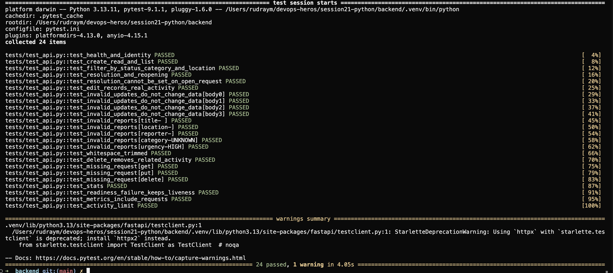

# Native terminal evidence — Rudray Mehra

24 BCS 10425 · Batch B.

## Fresh captures with the corrected name

Use the [native capture instructions and rubric audit](../SCREENSHOT-CHECKLIST.md).
The helper executes real commands and uses macOS window selection; it does not
render text into pretend terminal screenshots. New runs go into separate
`rudray-<timestamp>/` directories here, with logs, hashes and a review checklist.

[Local verification on 2026-10-16](rudray-local-verification-2026-10-16/README.md)
has real logs: 24 passing API tests, a successful React build and Helm lint.
Terraform validation failed in this sandbox and is recorded as such. This
non-interactive run produced **no new PNGs**; native capture is still required.

## Pytest on the student's Mac — 2026-10-13

The user supplied this original screenshot after running pytest in
`/Users/rudraym/devops-heros/session21-python/backend`. It shows Python 3.13.11,
`pytest.ini`, 24 passed tests and one deprecation warning. The warning is not a
test failure. The screenshot was copied byte-for-byte; no pixels were edited.

SHA-256: `024cd0c3d9a3bb3e321120d64c36647a845eb999869d23a88fde3b4b4bebbc24`.

This screenshot proves the displayed test run, not Docker, EKS, or presentation
completion. Further native screenshots must come from their corresponding runs.
