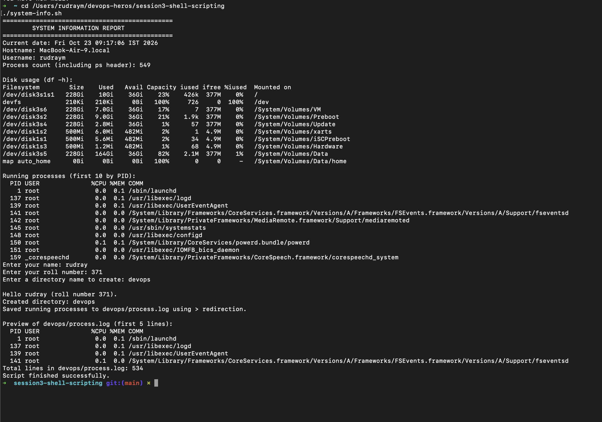
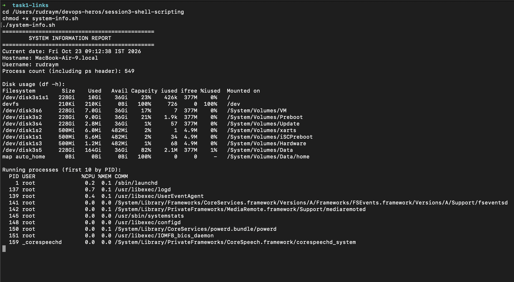
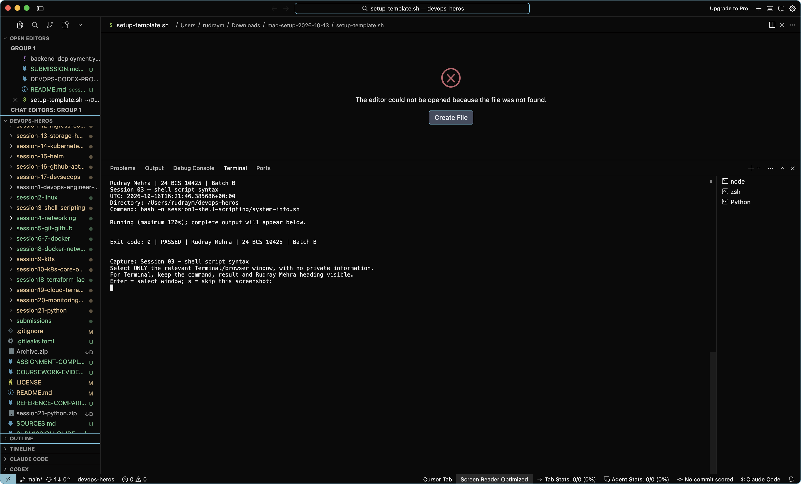
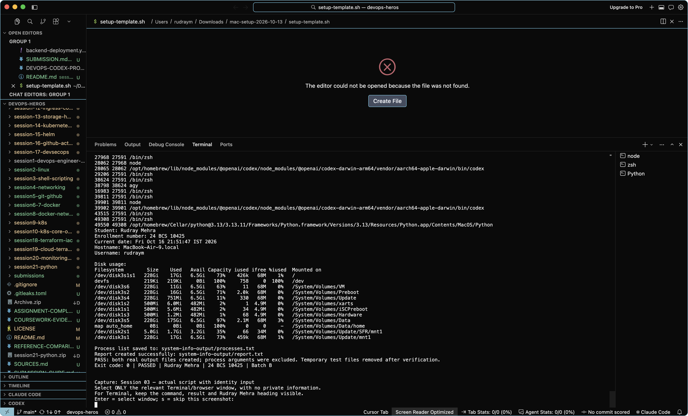

# Session 03 — evidence and screenshots

Rudray Mehra | 24 BCS 10425 | Batch B

Reference: Vivek's supplied ZIP. Filenames below are an audit inventory, not imported images.
No reference screenshot has been relabelled. A command log is not a native screenshot.

Required entry point/core-file checks: all listed files present (not a runtime pass).
Reference images: 3. Native captures: 4 accepted; 0 awaiting review; 0 rejected.

## Fresh execution records

### [rudray-20261023-091725](rudray-20261023-091725/README.md)

- Current `system-info.sh` run: EXECUTION PASS. It completed all prompts and wrote
  534 process rows to [`devops/process.log`](../devops/process.log). The capture
  shows `rudray` / `371`, which the user confirmed is correct for this assignment.

### [rudray-20261023-091529](rudray-20261023-091529/README.md)

- Current `system-info.sh` run: INCOMPLETE. The script stopped after process
  listing because `head` closed the `ps` pipe under `pipefail`; no prompts or
  process report ran. The script has been corrected to use `sed`, which consumes
  the complete input. This capture is not completion evidence.

### [rudray-20261016-212856-656600](rudray-20261016-212856-656600/README.md)

- [Session 03 — shell script syntax](rudray-20261016-212856-656600/01-syntax.txt): PASS.
- [Session 03 — actual script with identity input](rudray-20261016-212856-656600/02-system-info.txt): FAILED / BLOCKED.
- Reference-specific pending items: NOT RUN: Capture the actual system-info script and process/report files. Process arguments are omitted to avoid exposing credentials..

### [rudray-20261016-215104-093414](rudray-20261016-215104-093414/README.md)

- [Session 03 — shell script syntax](rudray-20261016-215104-093414/01-syntax.txt): PASS.

Reviewed native capture: Shell syntax command and success visible; syntax check only.

- [Session 03 — actual script with identity input](rudray-20261016-215104-093414/02-system-info.txt): PASS.

Reviewed native capture: Actual system-info output tail, Rudray identity and report-file verification visible; paired log has complete output.

- Reference-specific pending items: NOT RUN: Capture the actual system-info script and process/report files. Process arguments are omitted to avoid exposing credentials..

## Rendered record images (not native screenshots)

[View generated images of our actual logs/recorded CI metadata](rendered-log-views/README.md).
These are explicitly labelled renderings. They do not change native-capture counts or turn failures into passes.

## Existing historical evidence

- [Earlier GitHub Actions run](https://github.com/rudraymehra/devops-heros/actions/runs/38372002674)

Historical timestamps, identities and resource names remain unchanged. These links do not imply a current live deployment.

## Evidence follow-up

The corrected script completed and generated `devops/process.log`; process
arguments are omitted to avoid exposing credentials. The user confirmed `rudray`
and roll number `371` as the correct inputs for this assignment.

Use the [coursework capture guide](../../COURSEWORK-EVIDENCE.md). The helper displays Rudray Mehra around freshly executed commands.

## Reference image inventory (not copied)

- `screenshots/system-info-script-01.png`
- `screenshots/system-info-script-02.png`
- `screenshots/system-info-script-03.png`

## Checked source files

- [system-info.sh](../system-info.sh)
