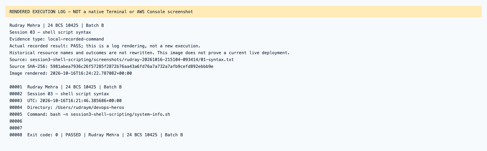
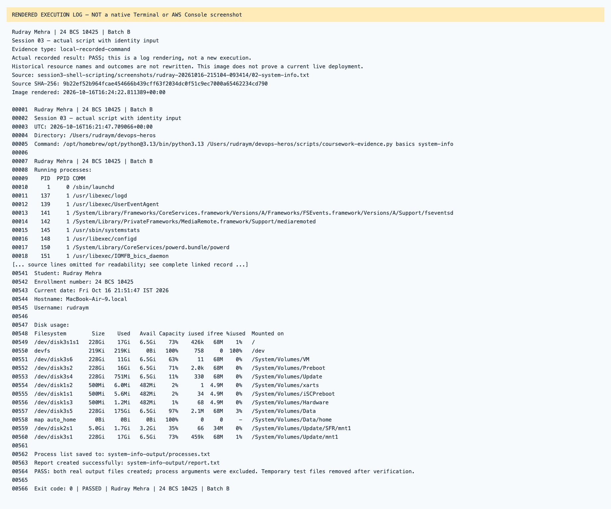

# Session 03 — rendered recorded evidence

Rudray Mehra · 24 BCS 10425 · Batch B

**Not native screenshots.** These PNGs render source-linked records. Historic resources are offline; failed attempts are not passes.
Current name in the heading identifies the submission. Old command/resource labels remain unchanged in excerpts.

## Session 03 — shell script syntax

Type: `local-recorded-command`.
[Original source](../rudray-20261016-215104-093414/01-syntax.txt) · [Rendered text](local-01-syntax.txt)

## Session 03 — actual script with identity input

Type: `local-recorded-command`.
[Original source](../rudray-20261016-215104-093414/02-system-info.txt) · [Rendered text](local-02-system-info.txt)

