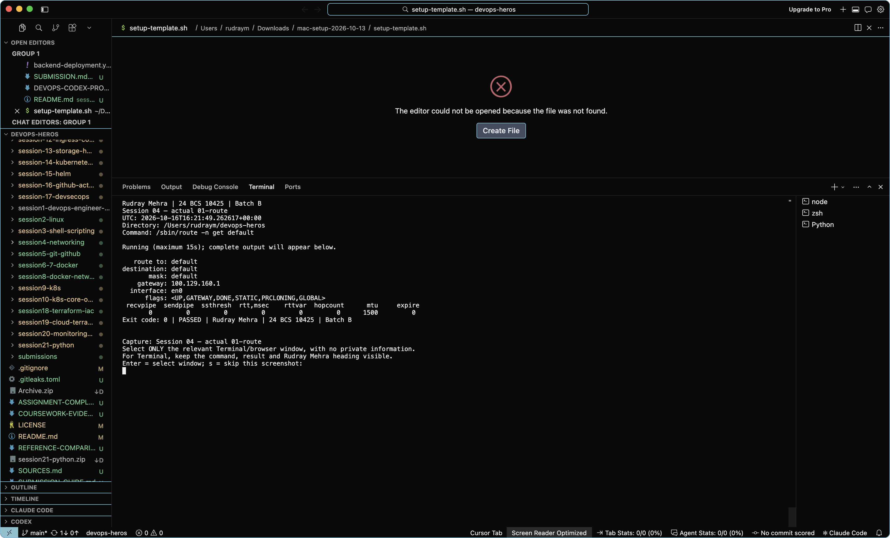
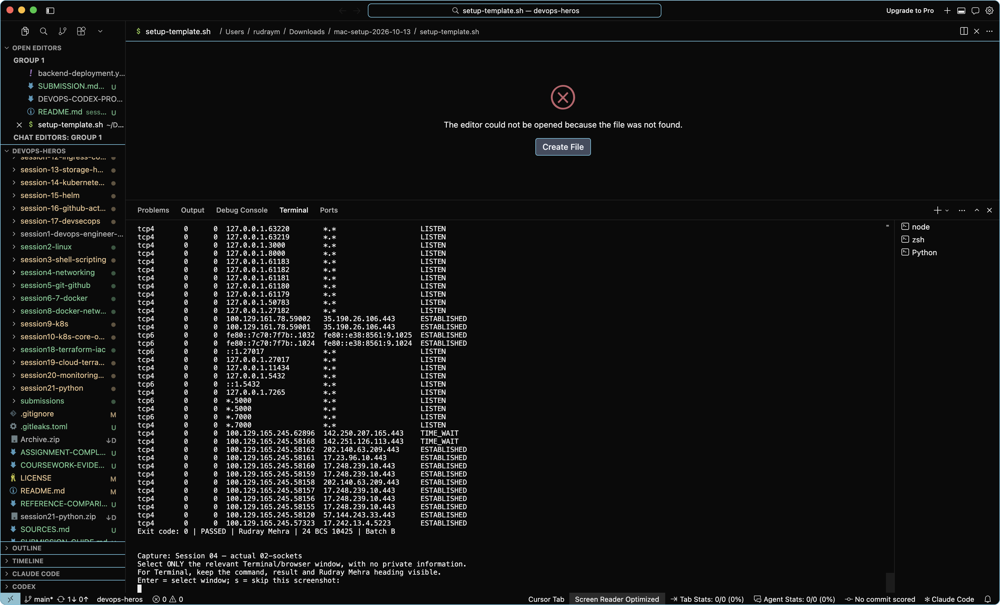
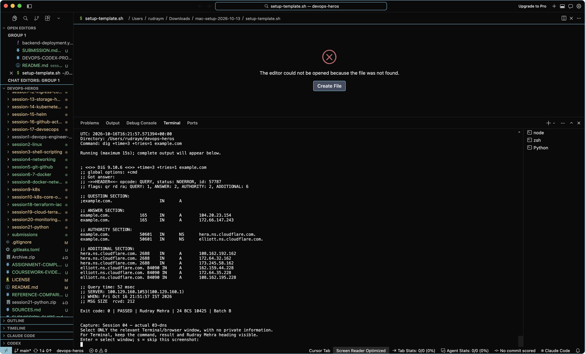
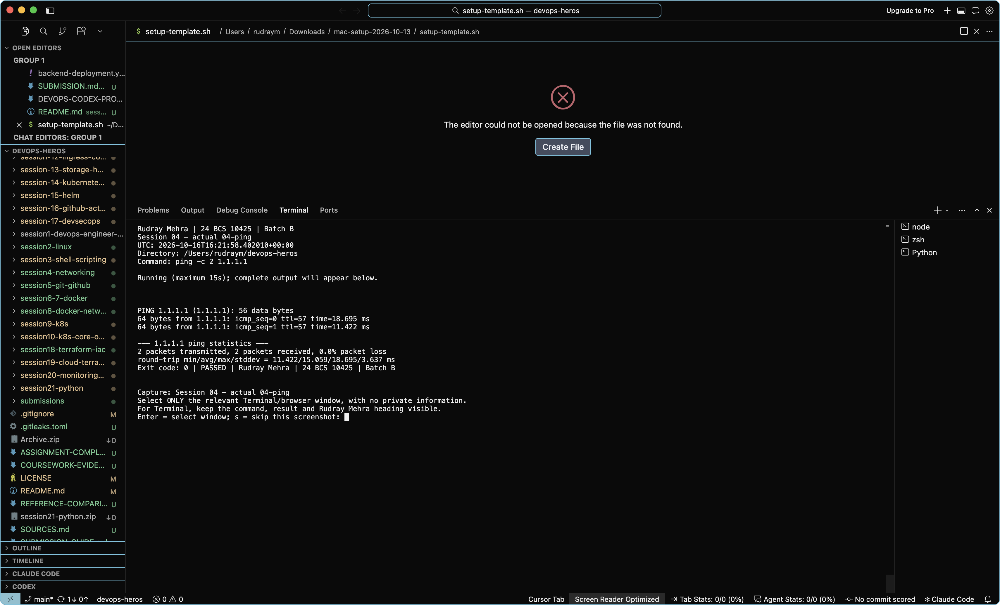

# Session 04 — evidence and screenshots

Rudray Mehra | 24 BCS 10425 | Batch B

Reference: Vivek's supplied ZIP. Filenames below are an audit inventory, not imported images.
No reference screenshot has been relabelled. A command log is not a native screenshot.

Required entry point/core-file checks: all listed files present (not a runtime pass).
Reference images: 6. Native captures: 4 accepted; 0 awaiting review; 1 rejected.

## Fresh execution records

### [rudray-20261016-213010-192514](rudray-20261016-213010-192514/README.md)

- [Session 04 — actual 01-route](rudray-20261016-213010-192514/01-route.txt): FAILED / BLOCKED.
- [Session 04 — actual 02-sockets](rudray-20261016-213010-192514/02-sockets.txt): FAILED / BLOCKED.
- [Session 04 — actual 03-dns](rudray-20261016-213010-192514/03-dns.txt): FAILED / BLOCKED.
- [Session 04 — actual 04-ping](rudray-20261016-213010-192514/04-ping.txt): FAILED / BLOCKED.
- [Session 04 — actual 05-http](rudray-20261016-213010-192514/05-http.txt): FAILED / BLOCKED.
- Reference-specific pending items: NOT RUN: Capture routes, sockets, DNS, ping and HTTP on the actual host. Record network restrictions as failures, not successful connectivity..

### [rudray-20261016-215104-093414](rudray-20261016-215104-093414/README.md)

- [Session 04 — actual 01-route](rudray-20261016-215104-093414/01-route.txt): PASS.

Reviewed native capture: Actual default-route output and Rudray heading visible.

- [Session 04 — actual 02-sockets](rudray-20261016-215104-093414/02-sockets.txt): PASS.

Reviewed native capture: Socket output tail and identity visible; command is above the viewport, so use the paired original log for context.

- [Session 04 — actual 03-dns](rudray-20261016-215104-093414/03-dns.txt): PASS.

Reviewed native capture: Actual DNS result and Rudray heading visible.

- [Session 04 — actual 04-ping](rudray-20261016-215104-093414/04-ping.txt): PASS.

Reviewed native capture: Actual ping results and Rudray heading visible.

- [Session 04 — actual 05-http](rudray-20261016-215104-093414/05-http.txt): FAILED / BLOCKED.
- Native capture REJECTED: Wrong window: chat conversation instead of HTTP command output. Retake; the paired curl log records a timeout, not success.
- Reference-specific pending items: NOT RUN: Capture routes, sockets, DNS, ping and HTTP on the actual host. Record network restrictions as failures, not successful connectivity..

## Rendered record images (not native screenshots)

[View generated images of our actual logs/recorded CI metadata](rendered-log-views/README.md).
These are explicitly labelled renderings. They do not change native-capture counts or turn failures into passes.

## Existing historical evidence

- [Earlier GitHub Actions run](https://github.com/rudraymehra/devops-heros/actions/runs/38372002674)

Historical timestamps, identities and resource names remain unchanged. These links do not imply a current live deployment.

## Still needs genuine capture

Capture routes, sockets, DNS, ping and HTTP on the actual host. Record network restrictions as failures, not successful connectivity.

Use the [coursework capture guide](../../COURSEWORK-EVIDENCE.md). The helper displays Rudray Mehra around freshly executed commands.

## Reference image inventory (not copied)

- `screenshots/networking-01.png`
- `screenshots/networking-02.png`
- `screenshots/networking-03.png`
- `screenshots/networking-04.png`
- `screenshots/networking-05.png`
- `screenshots/networking-06.png`

## Checked source files

- [collect-network-info.sh](../collect-network-info.sh)
