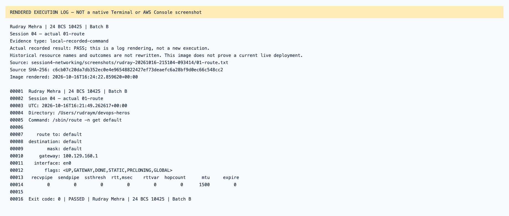
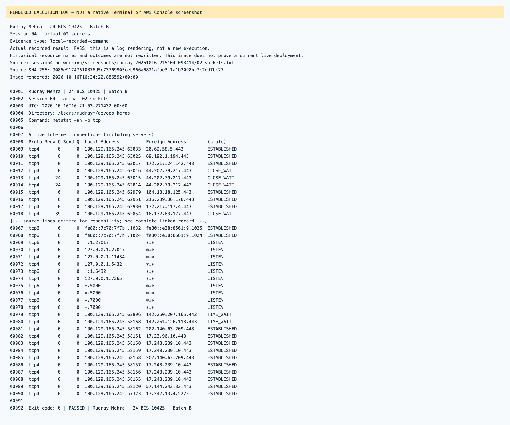
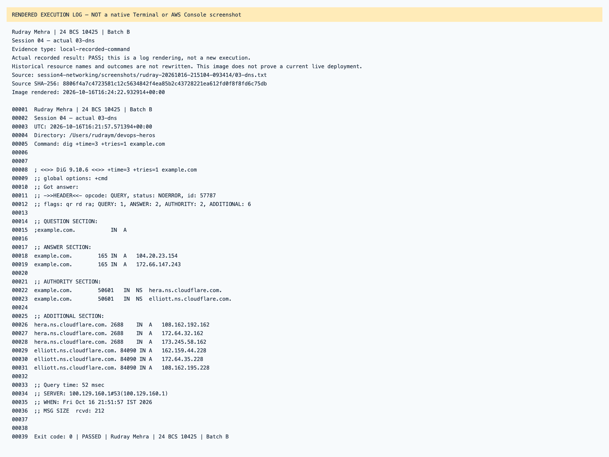
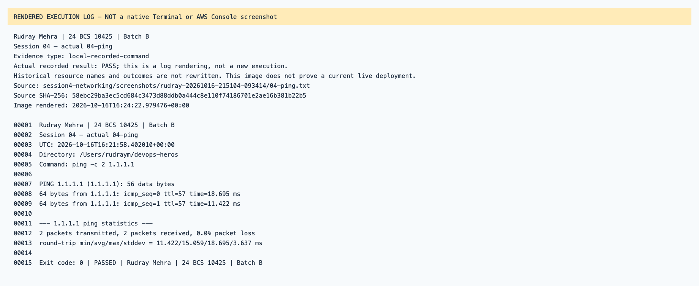
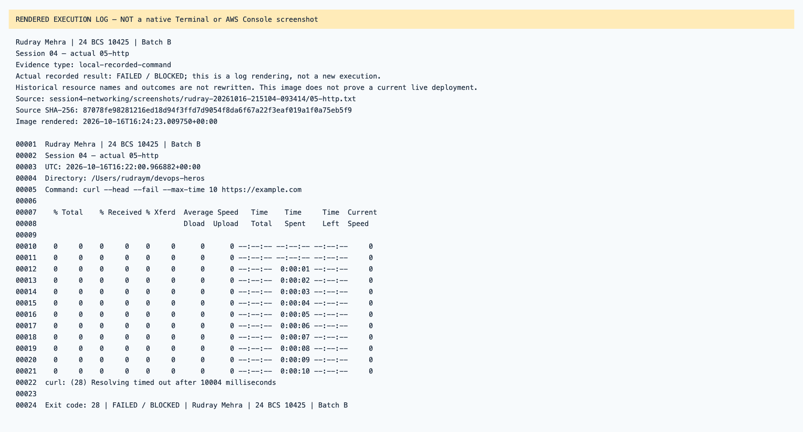

# Session 04 — rendered recorded evidence

Rudray Mehra · 24 BCS 10425 · Batch B

**Not native screenshots.** These PNGs render source-linked records. Historic resources are offline; failed attempts are not passes.
Current name in the heading identifies the submission. Old command/resource labels remain unchanged in excerpts.

## Session 04 — actual 01-route

Type: `local-recorded-command`.
[Original source](../rudray-20261016-215104-093414/01-route.txt) · [Rendered text](local-01-route.txt)

## Session 04 — actual 02-sockets

Type: `local-recorded-command`.
[Original source](../rudray-20261016-215104-093414/02-sockets.txt) · [Rendered text](local-02-sockets.txt)

## Session 04 — actual 03-dns

Type: `local-recorded-command`.
[Original source](../rudray-20261016-215104-093414/03-dns.txt) · [Rendered text](local-03-dns.txt)

## Session 04 — actual 04-ping

Type: `local-recorded-command`.
[Original source](../rudray-20261016-215104-093414/04-ping.txt) · [Rendered text](local-04-ping.txt)

## Session 04 — actual 05-http

Type: `local-recorded-command`.
[Original source](../rudray-20261016-215104-093414/05-http.txt) · [Rendered text](local-05-http.txt)

