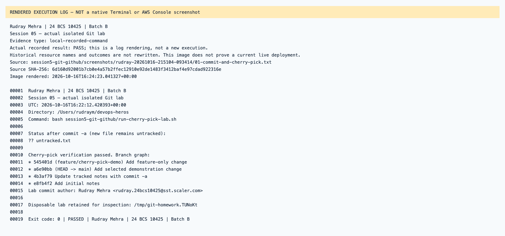

# Session 05 — rendered recorded evidence

Rudray Mehra · 24 BCS 10425 · Batch B

**Not native screenshots.** These PNGs render source-linked records. Historic resources are offline; failed attempts are not passes.
Current name in the heading identifies the submission. Old command/resource labels remain unchanged in excerpts.

## Session 05 — actual isolated Git lab

Type: `local-recorded-command`.
[Original source](../rudray-20261016-215104-093414/01-commit-and-cherry-pick.txt) · [Rendered text](local-01-commit-and-cherry-pick.txt)

