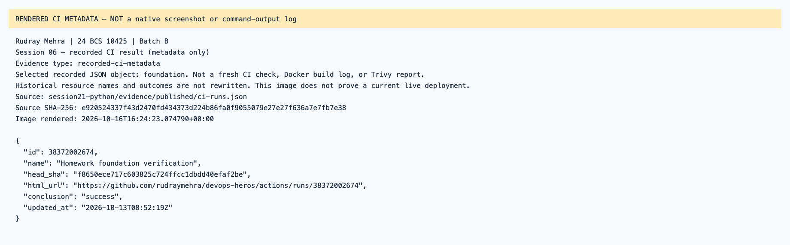

# Session 06 — rendered recorded evidence

Rudray Mehra · 24 BCS 10425 · Batch B

**Not native screenshots.** These PNGs render source-linked records. Historic resources are offline; failed attempts are not passes.
Current name in the heading identifies the submission. Old command/resource labels remain unchanged in excerpts.

## Session 06 — recorded CI result (metadata only)

Type: `recorded-ci-metadata`.
[Original source](../../../session21-python/evidence/published/ci-runs.json) · [Rendered text](recorded-ci-result.txt)

