# Session 10 — rendered recorded evidence

Rudray Mehra · 24 BCS 10425 · Batch B

**Not native screenshots.** These PNGs render source-linked records. Historic resources are offline; failed attempts are not passes.
Current name in the heading identifies the submission. Old command/resource labels remain unchanged in excerpts.

## Session 10 — recorded command excerpt

Type: `historical-command-excerpt`.
[Original source](../../OUTPUT.md) · [Rendered text](historical-output-line-12.txt)

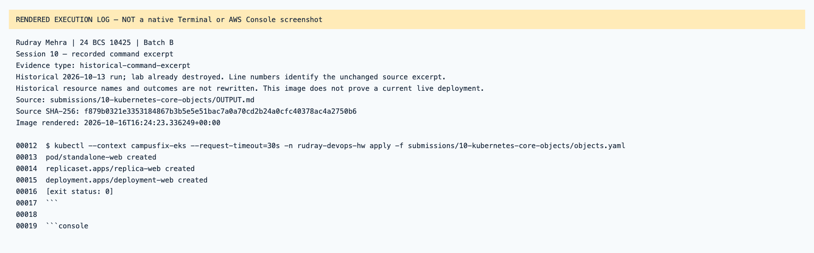

## Session 10 — recorded command excerpt

Type: `historical-command-excerpt`.
[Original source](../../OUTPUT.md) · [Rendered text](historical-output-line-41.txt)

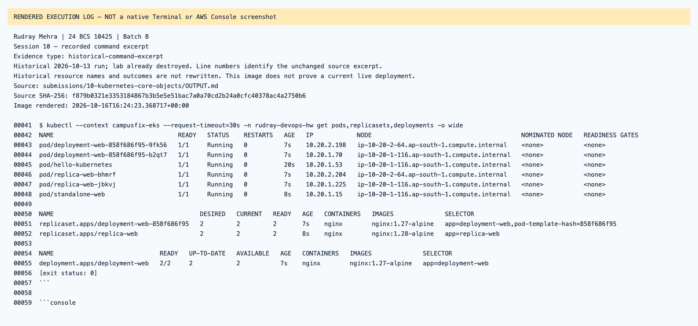

## Session 10 — recorded command excerpt

Type: `historical-command-excerpt`.
[Original source](../../OUTPUT.md) · [Rendered text](historical-output-line-554.txt)

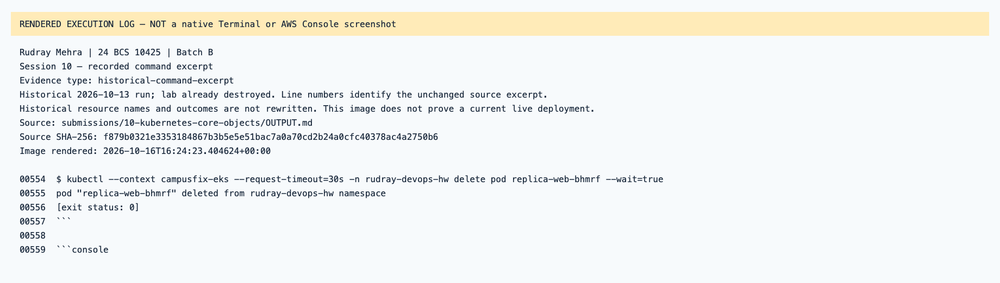

## Session 10 — recorded command excerpt

Type: `historical-command-excerpt`.
[Original source](../../OUTPUT.md) · [Rendered text](historical-output-line-1069.txt)

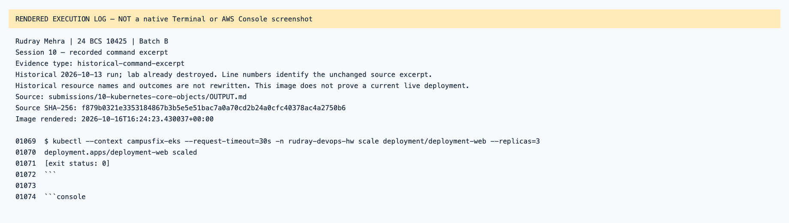

## Session 10 — recorded command excerpt

Type: `historical-command-excerpt`.
[Original source](../../OUTPUT.md) · [Rendered text](historical-output-line-1082.txt)

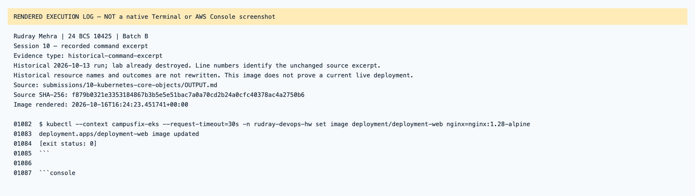

## Session 10 — recorded command excerpt

Type: `historical-command-excerpt`.
[Original source](../../OUTPUT.md) · [Rendered text](historical-output-line-1104.txt)

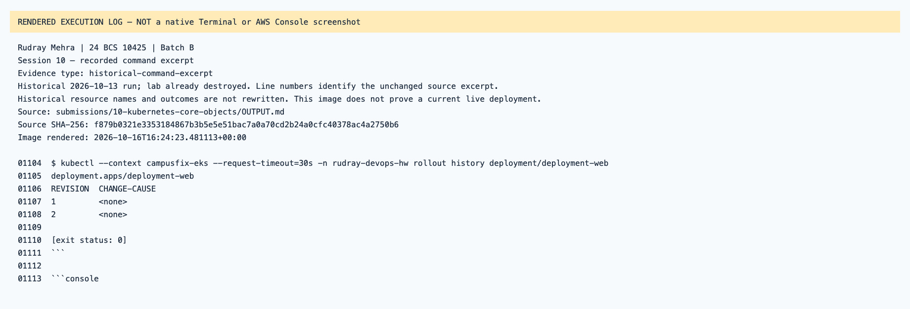

## Session 10 — recorded command excerpt

Type: `historical-command-excerpt`.
[Original source](../../OUTPUT.md) · [Rendered text](historical-output-line-1114.txt)

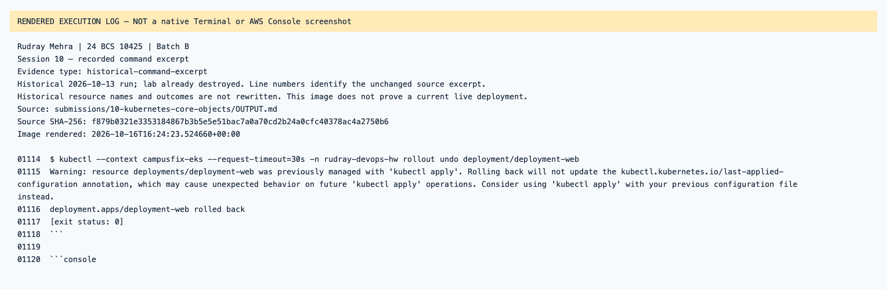

## Session 10 — recorded command excerpt

Type: `historical-command-excerpt`.
[Original source](../../OUTPUT.md) · [Rendered text](historical-output-line-1142.txt)

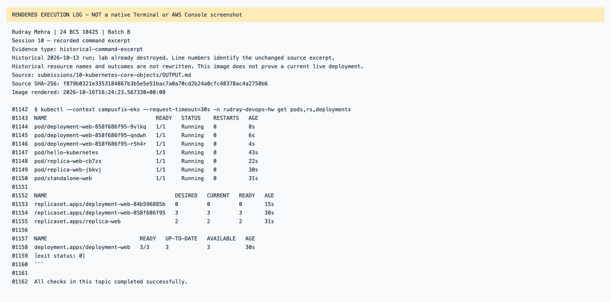

## Session 10 — recorded command excerpt

Type: `historical-command-excerpt`.
[Original source](../../STRATEGIES-SUCCESS.md) · [Rendered text](historical-strategies-success-line-55.txt)

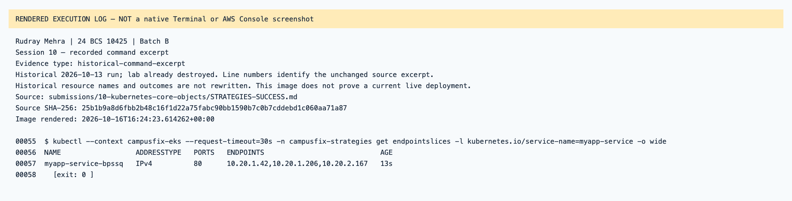

## Session 10 — recorded command excerpt

Type: `historical-command-excerpt`.
[Original source](../../STRATEGIES-SUCCESS.md) · [Rendered text](historical-strategies-success-line-81.txt)

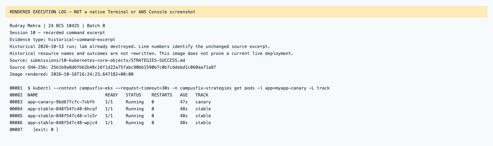

## Session 10 — recorded command excerpt

Type: `historical-command-excerpt`.
[Original source](../../STRATEGIES-SUCCESS.md) · [Rendered text](historical-strategies-success-line-363.txt)

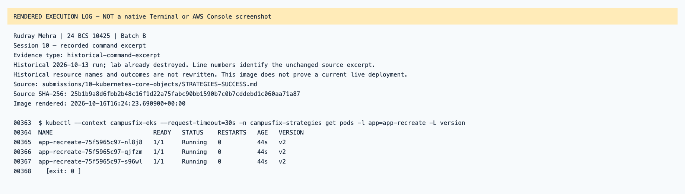
