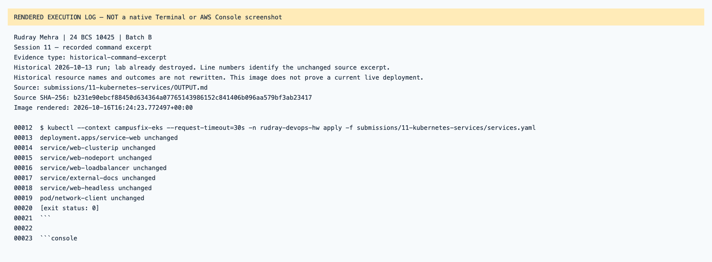
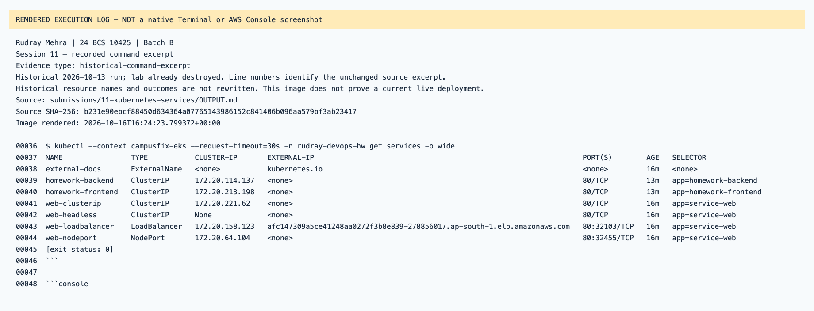
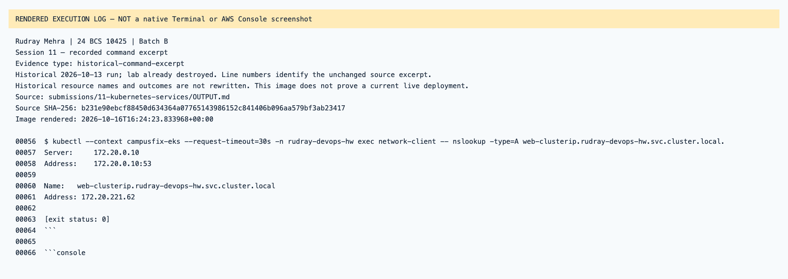
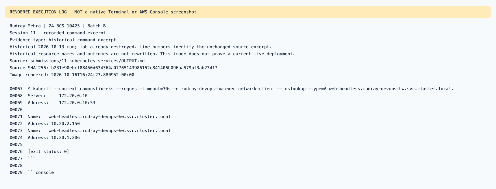
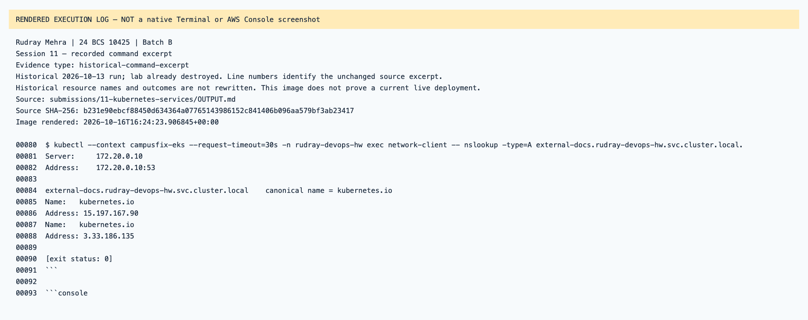
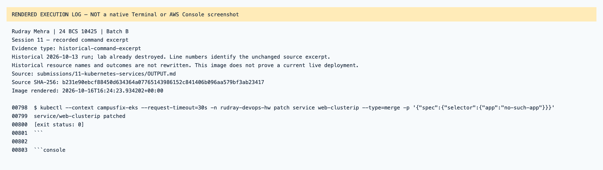
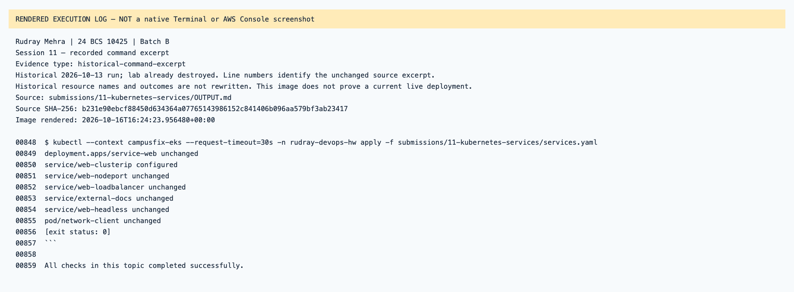

# Session 11 — rendered recorded evidence

Rudray Mehra · 24 BCS 10425 · Batch B

**Not native screenshots.** These PNGs render source-linked records. Historic resources are offline; failed attempts are not passes.
Current name in the heading identifies the submission. Old command/resource labels remain unchanged in excerpts.

## Session 11 — recorded command excerpt

Type: `historical-command-excerpt`.
[Original source](../../OUTPUT.md) · [Rendered text](historical-output-line-12.txt)

## Session 11 — recorded command excerpt

Type: `historical-command-excerpt`.
[Original source](../../OUTPUT.md) · [Rendered text](historical-output-line-36.txt)

## Session 11 — recorded command excerpt

Type: `historical-command-excerpt`.
[Original source](../../OUTPUT.md) · [Rendered text](historical-output-line-56.txt)

## Session 11 — recorded command excerpt

Type: `historical-command-excerpt`.
[Original source](../../OUTPUT.md) · [Rendered text](historical-output-line-67.txt)

## Session 11 — recorded command excerpt

Type: `historical-command-excerpt`.
[Original source](../../OUTPUT.md) · [Rendered text](historical-output-line-80.txt)

## Session 11 — recorded command excerpt

Type: `historical-command-excerpt`.
[Original source](../../OUTPUT.md) · [Rendered text](historical-output-line-798.txt)

## Session 11 — recorded command excerpt

Type: `historical-command-excerpt`.
[Original source](../../OUTPUT.md) · [Rendered text](historical-output-line-848.txt)

