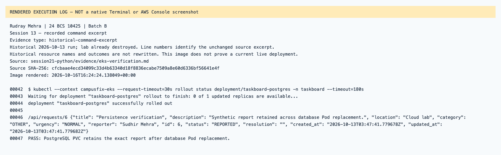
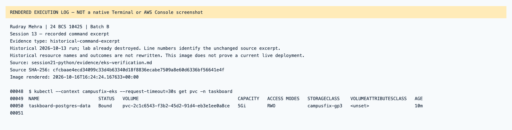
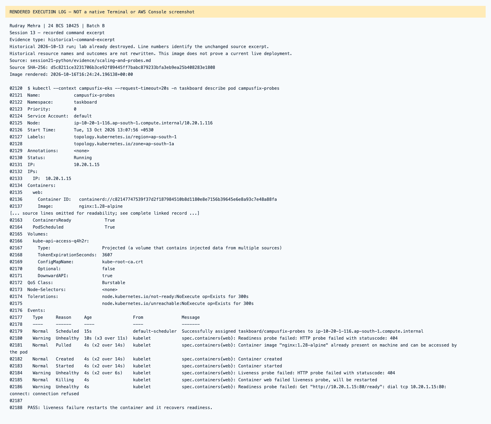

# Session 13 — rendered recorded evidence

Rudray Mehra · 24 BCS 10425 · Batch B

**Not native screenshots.** These PNGs render source-linked records. Historic resources are offline; failed attempts are not passes.
Current name in the heading identifies the submission. Old command/resource labels remain unchanged in excerpts.

## Session 13 — recorded command excerpt

Type: `historical-command-excerpt`.
[Original source](../../../../session21-python/evidence/eks-verification.md) · [Rendered text](historical-eks-verification-line-42.txt)

## Session 13 — recorded command excerpt

Type: `historical-command-excerpt`.
[Original source](../../../../session21-python/evidence/eks-verification.md) · [Rendered text](historical-eks-verification-line-48.txt)

## Session 13 — recorded command excerpt

Type: `historical-command-excerpt`.
[Original source](../../../../session21-python/evidence/scaling-and-probes.md) · [Rendered text](historical-scaling-and-probes-line-2120.txt)

