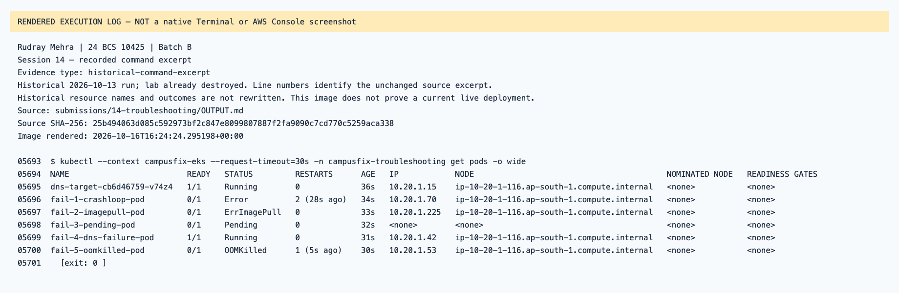
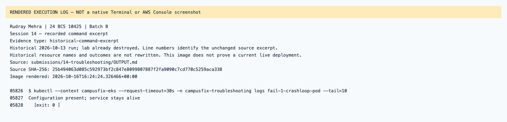
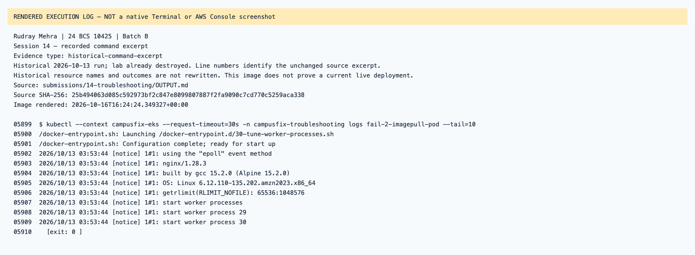
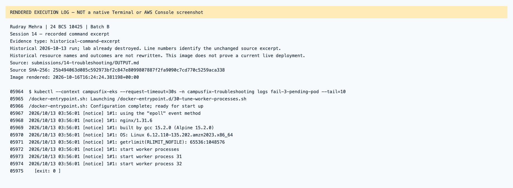
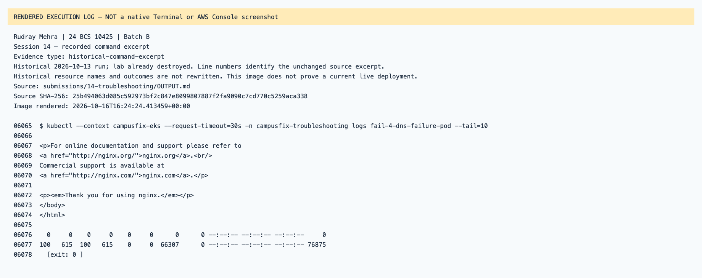
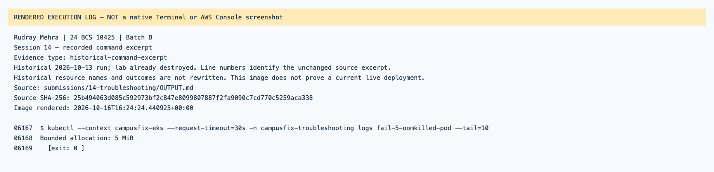
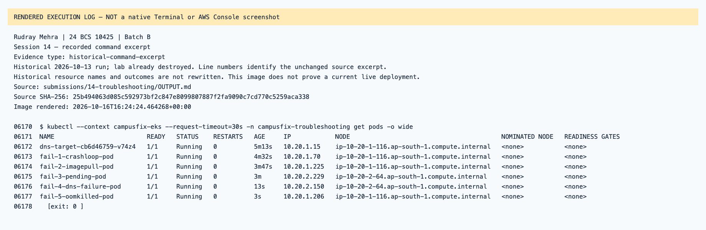

# Session 14 — rendered recorded evidence

Rudray Mehra · 24 BCS 10425 · Batch B

**Not native screenshots.** These PNGs render source-linked records. Historic resources are offline; failed attempts are not passes.
Current name in the heading identifies the submission. Old command/resource labels remain unchanged in excerpts.

## Session 14 — recorded command excerpt

Type: `historical-command-excerpt`.
[Original source](../../OUTPUT.md) · [Rendered text](historical-output-line-5693.txt)

## Session 14 — recorded command excerpt

Type: `historical-command-excerpt`.
[Original source](../../OUTPUT.md) · [Rendered text](historical-output-line-5826.txt)

## Session 14 — recorded command excerpt

Type: `historical-command-excerpt`.
[Original source](../../OUTPUT.md) · [Rendered text](historical-output-line-5899.txt)

## Session 14 — recorded command excerpt

Type: `historical-command-excerpt`.
[Original source](../../OUTPUT.md) · [Rendered text](historical-output-line-5964.txt)

## Session 14 — recorded command excerpt

Type: `historical-command-excerpt`.
[Original source](../../OUTPUT.md) · [Rendered text](historical-output-line-6065.txt)

## Session 14 — recorded command excerpt

Type: `historical-command-excerpt`.
[Original source](../../OUTPUT.md) · [Rendered text](historical-output-line-6167.txt)

## Session 14 — recorded command excerpt

Type: `historical-command-excerpt`.
[Original source](../../OUTPUT.md) · [Rendered text](historical-output-line-6170.txt)

