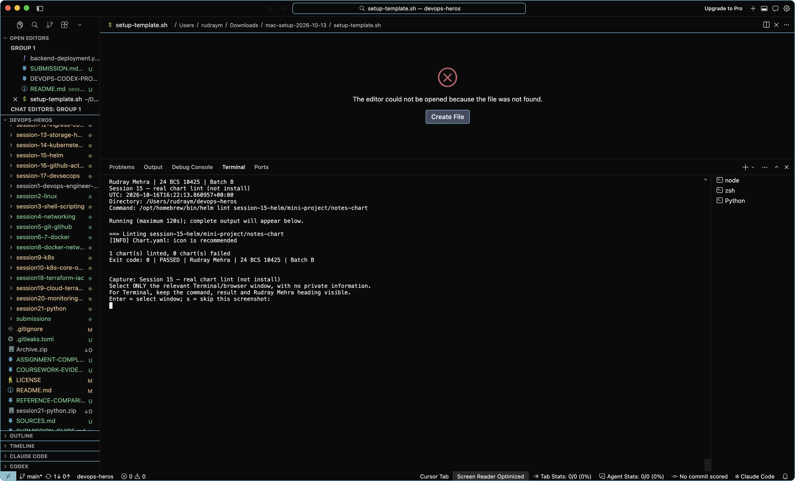
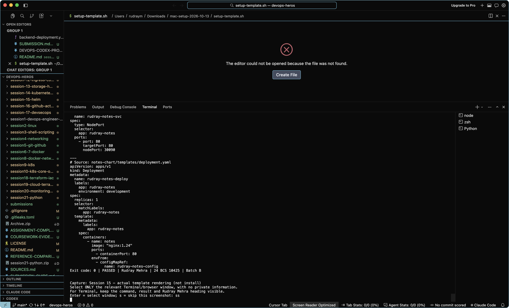

# Session 15 — evidence and screenshots

Rudray Mehra | 24 BCS 10425 | Batch B

Reference: Vivek's supplied ZIP. Filenames below are an audit inventory, not imported images.
No reference screenshot has been relabelled. A command log is not a native screenshot.

Required entry point/core-file checks: all listed files present (not a runtime pass).
Reference images: 11. Native captures: 2 accepted; 0 awaiting review; 0 rejected.

## Fresh execution records

### [rudray-20261016-212856-656600](rudray-20261016-212856-656600/README.md)

- [Session 15 — real chart lint (not install)](rudray-20261016-212856-656600/01-helm-lint.txt): PASS.
- [Session 15 — actual template rendering (not install)](rudray-20261016-212856-656600/02-helm-template.txt): PASS.
- Live Kubernetes/Helm/monitoring capture: NOT RUN: No explicit --kube-context provided; historical EKS lab was destroyed.
- Reference-specific pending items: NOT RUN: Lint/template can run offline. Install, upgrade, history, rollback and uninstall screenshots require their actual lifecycle, not lint output..

### [rudray-20261016-215104-093414](rudray-20261016-215104-093414/README.md)

- [Session 15 — real chart lint (not install)](rudray-20261016-215104-093414/01-helm-lint.txt): PASS.

Reviewed native capture: Actual Helm lint output visible; not proof of installing a release.

- [Session 15 — actual template rendering (not install)](rudray-20261016-215104-093414/02-helm-template.txt): PASS.

Reviewed native capture: Actual rendered-manifest output tail visible; paired log gives command context. Not proof of a live deployment.

- Live Kubernetes/Helm/monitoring capture: NOT RUN: No explicit --kube-context provided; historical EKS lab was destroyed.
- Reference-specific pending items: NOT RUN: Lint/template can run offline. Install, upgrade, history, rollback and uninstall screenshots require their actual lifecycle, not lint output..

## Rendered record images (not native screenshots)

[View generated images of our actual logs/recorded CI metadata](rendered-log-views/README.md).
These are explicitly labelled renderings. They do not change native-capture counts or turn failures into passes.

## Existing historical evidence

- [OUTPUT.md](../OUTPUT.md)

Historical timestamps, identities and resource names remain unchanged. These links do not imply a current live deployment.

## Still needs genuine capture

Lint/template can run offline. Install, upgrade, history, rollback and uninstall screenshots require their actual lifecycle, not lint output.

Use the [coursework capture guide](../../../COURSEWORK-EVIDENCE.md). The helper displays Rudray Mehra around freshly executed commands.

## Reference image inventory (not copied)

- `screenshots/task1-helm-create-lint-template-01.png`
- `screenshots/task1-helm-create-lint-template-02.png`
- `screenshots/task1-helm-create-lint-template-03.png`
- `screenshots/task1-helm-install-list-status-get-01.png`
- `screenshots/task1-helm-install-list-status-get-02.png`
- `screenshots/task1-helm-repo-search-01.png`
- `screenshots/task1-helm-upgrade-history-rollback-uninstall-01.png`
- `screenshots/task2-rollback-workflow-01.png`
- `screenshots/task2-rollback-workflow-02.png`
- `screenshots/task3-mini-project-01.png`
- `screenshots/task3-mini-project-02.png`

## Checked source files

- [Chart.yaml](../../../session-15-helm/mini-project/notes-chart/Chart.yaml)
