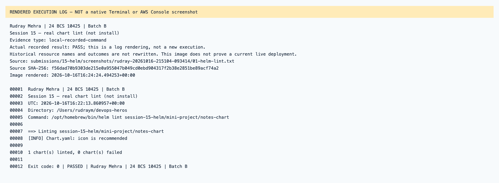
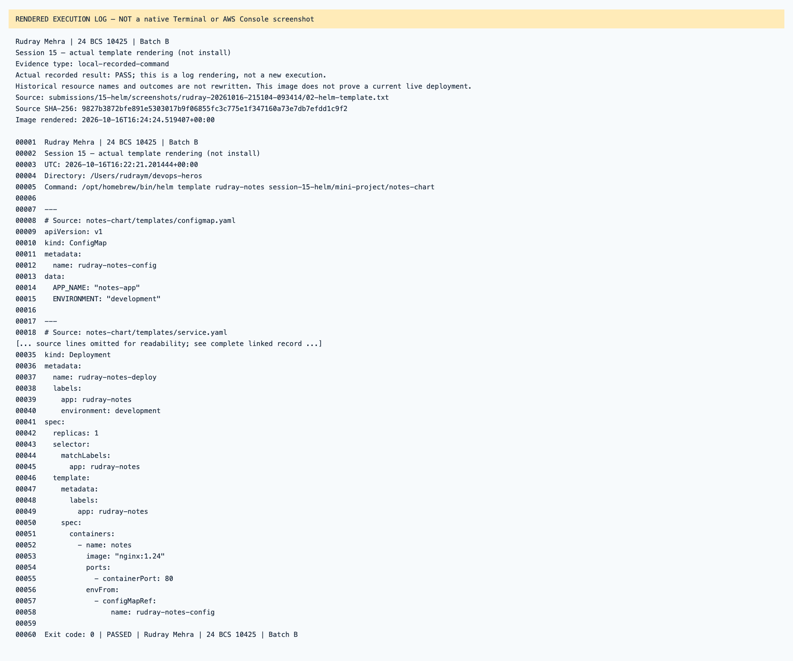
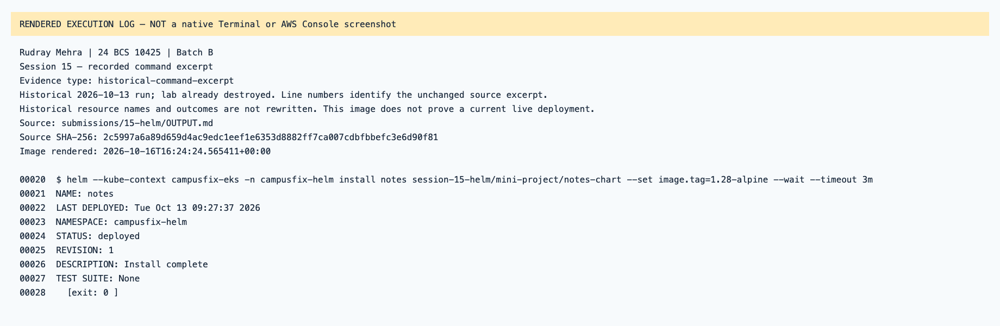
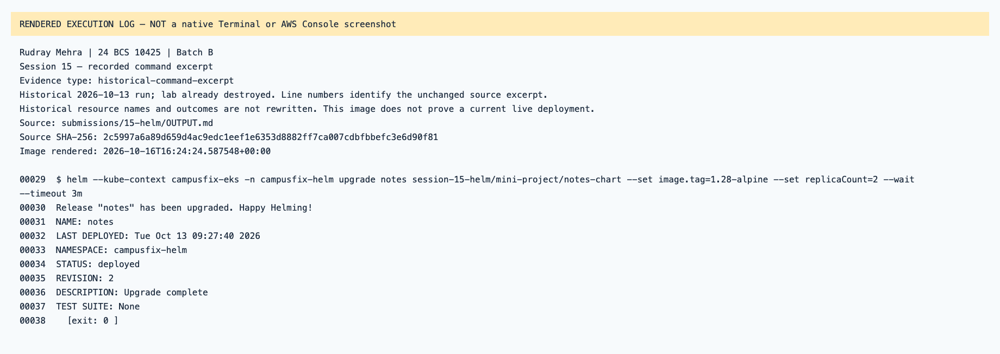
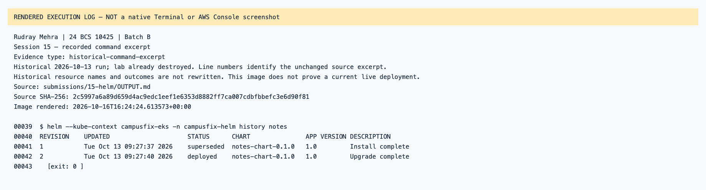
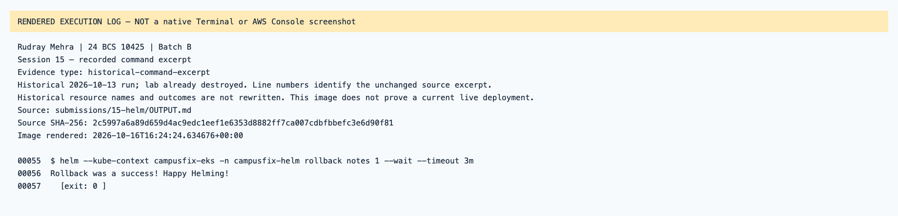
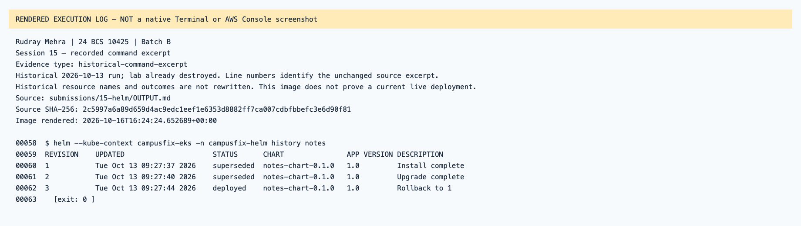
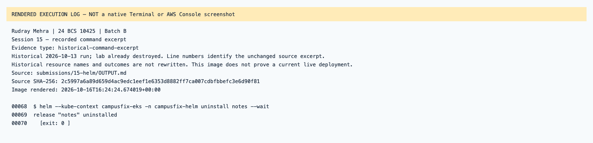

# Session 15 — rendered recorded evidence

Rudray Mehra · 24 BCS 10425 · Batch B

**Not native screenshots.** These PNGs render source-linked records. Historic resources are offline; failed attempts are not passes.
Current name in the heading identifies the submission. Old command/resource labels remain unchanged in excerpts.

## Session 15 — real chart lint (not install)

Type: `local-recorded-command`.
[Original source](../rudray-20261016-215104-093414/01-helm-lint.txt) · [Rendered text](local-01-helm-lint.txt)

## Session 15 — actual template rendering (not install)

Type: `local-recorded-command`.
[Original source](../rudray-20261016-215104-093414/02-helm-template.txt) · [Rendered text](local-02-helm-template.txt)

## Session 15 — recorded command excerpt

Type: `historical-command-excerpt`.
[Original source](../../OUTPUT.md) · [Rendered text](historical-output-line-20.txt)

## Session 15 — recorded command excerpt

Type: `historical-command-excerpt`.
[Original source](../../OUTPUT.md) · [Rendered text](historical-output-line-29.txt)

## Session 15 — recorded command excerpt

Type: `historical-command-excerpt`.
[Original source](../../OUTPUT.md) · [Rendered text](historical-output-line-39.txt)

## Session 15 — recorded command excerpt

Type: `historical-command-excerpt`.
[Original source](../../OUTPUT.md) · [Rendered text](historical-output-line-55.txt)

## Session 15 — recorded command excerpt

Type: `historical-command-excerpt`.
[Original source](../../OUTPUT.md) · [Rendered text](historical-output-line-58.txt)

## Session 15 — recorded command excerpt

Type: `historical-command-excerpt`.
[Original source](../../OUTPUT.md) · [Rendered text](historical-output-line-68.txt)

