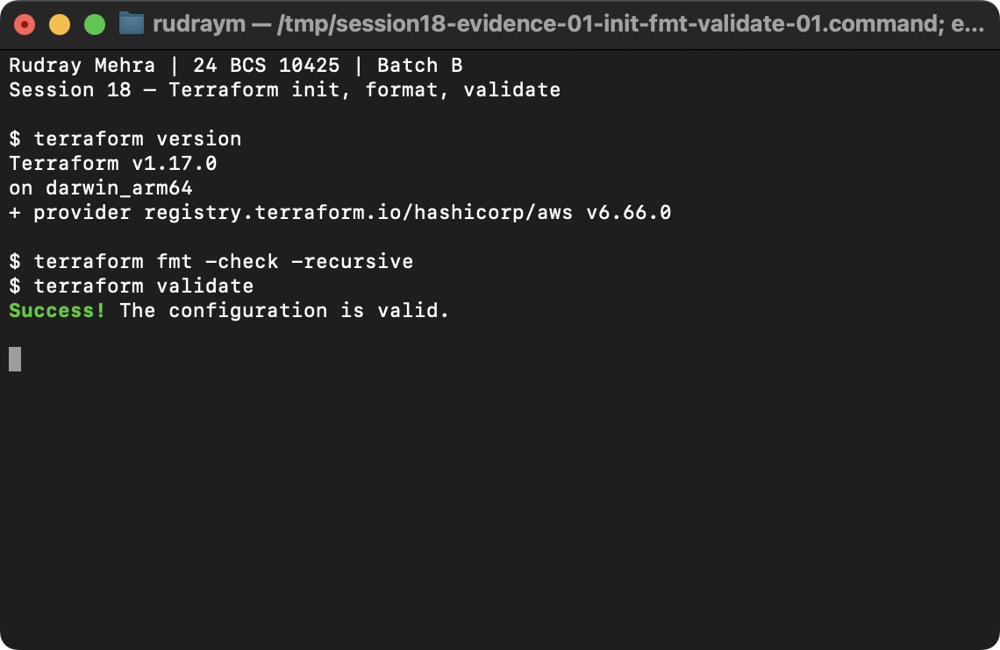
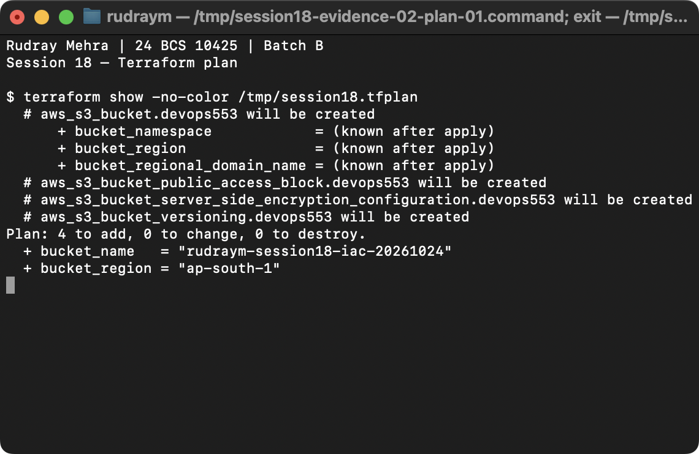
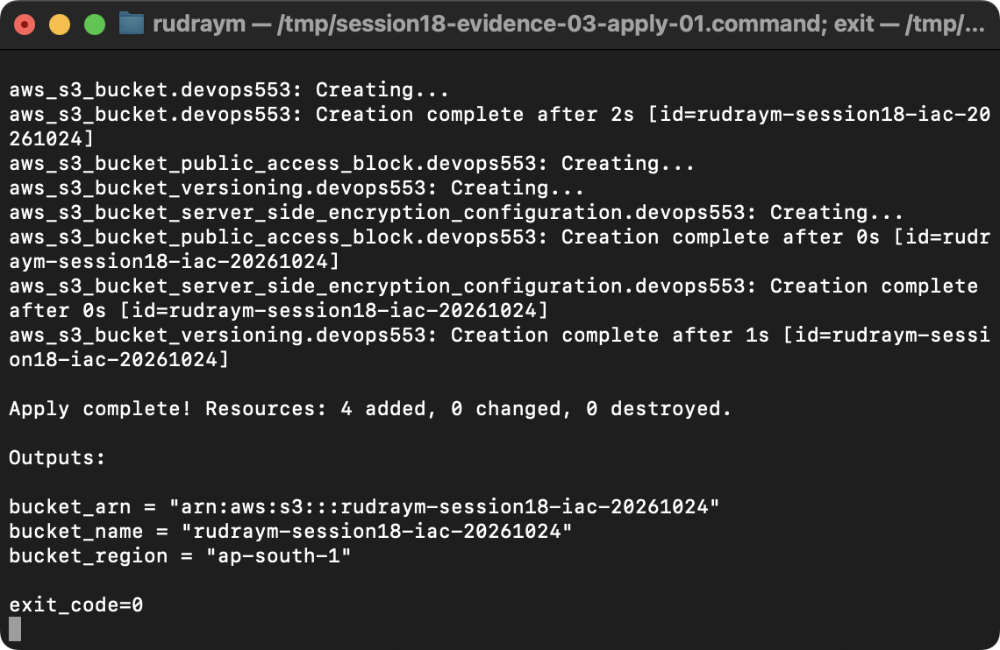
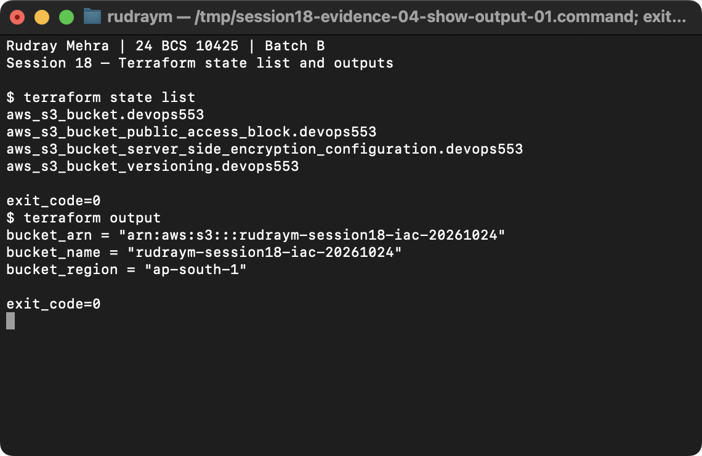
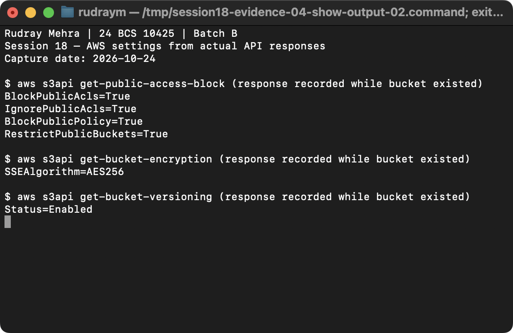
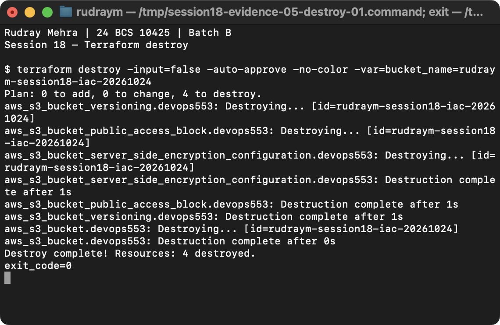
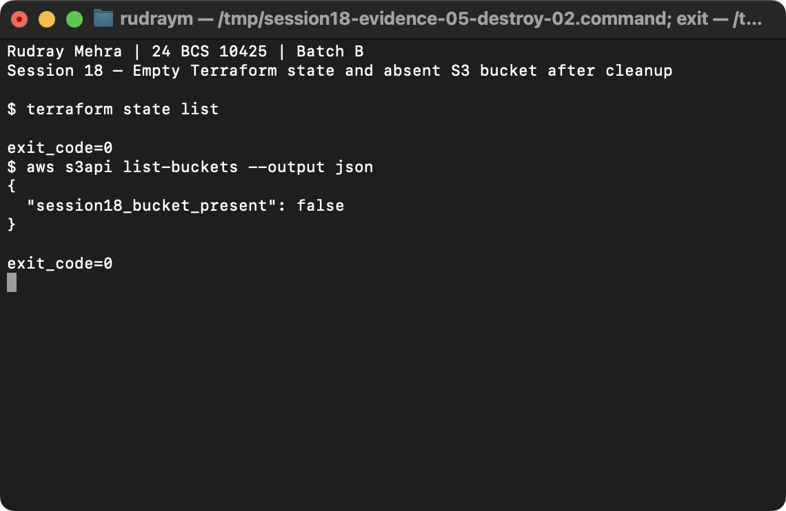

# Session 18 native screenshot run — 2026-10-24

Rudray Mehra | 24 BCS 10425 | Batch B

These are untouched screenshots captured from native macOS Terminal windows. The Terminal displayed actual saved outputs from the run; screenshots of apply/destroy logs were captured after the operations completed. The AWS security settings image is labelled as a summary from saved API responses gathered before bucket deletion. Every image was visually reviewed and SHA-256 recorded in [native-review.json](../../../../evidence/coursework/native-review.json).

## Terraform init, fmt check, and validate

PASS. Terraform version, fmt check, and validate logs; successful validation is visible.

- [Actual command record](../../current-run-20261024/00-terraform-version.txt)
- [Actual command record](../../current-run-20261024/01-fmt-check.txt)
- [Actual command record](../../current-run-20261024/02-validate.txt)

## Terraform plan

PASS. The actual saved plan shows four additions and no changes or destroys.

- [Actual command record](../../current-run-20261024/03-plan.txt)

## Terraform apply

PASS. Actual saved apply output shows all four resources created and outputs; captured after execution from the preserved command log.

- [Actual command record](../../current-run-20261024/04-apply.txt)

## Terraform state list and outputs

PASS. Actual saved state and output command logs show the four resources and bucket outputs before cleanup.

- [Actual command record](../../current-run-20261024/05-state-list.txt)
- [Actual command record](../../current-run-20261024/06-outputs.txt)

## AWS bucket security settings

PASS. Native Terminal capture of a concise summary parsed from the actual saved AWS API responses. The bucket was later destroyed; raw responses remain in current-run logs.

- [Actual command record](../../current-run-20261024/14-bucket-security-summary.txt)
- [Actual command record](../../current-run-20261024/07-bucket-configuration.json)
- [Actual command record](../../current-run-20261024/08-bucket-encryption.json)
- [Actual command record](../../current-run-20261024/09-bucket-versioning.json)

## Terraform destroy

PASS. Actual saved destroy output shows four resources destroyed; captured after execution from the preserved command log.

- [Actual command record](../../current-run-20261024/11-destroy-success.txt)

## Post-destroy verification

PASS. Actual saved Terraform state list is empty and AWS list-buckets confirms the Session 18 bucket is absent.

- [Actual command record](../../current-run-20261024/12-state-after-destroy.txt)
- [Actual command record](../../current-run-20261024/13-bucket-list-after-destroy.json)

