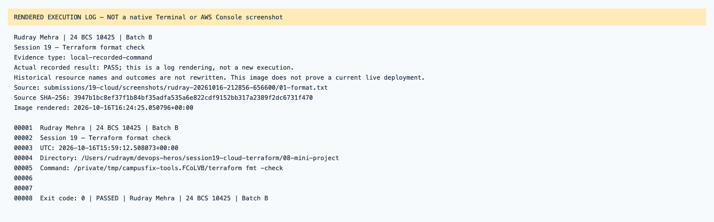
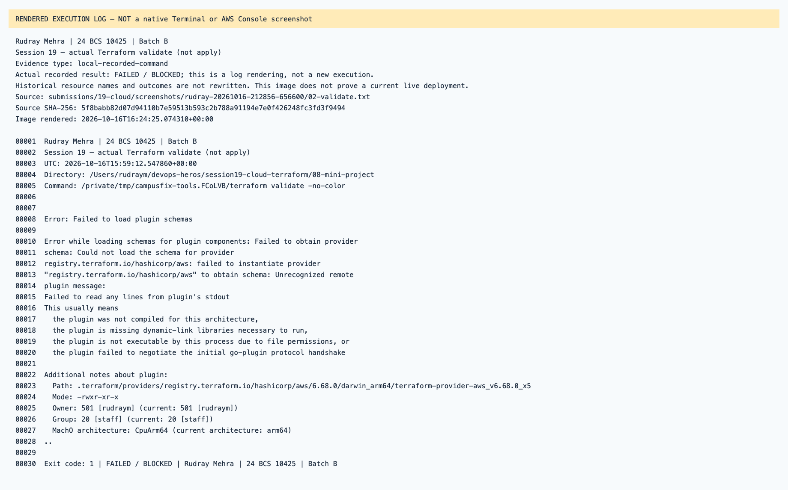
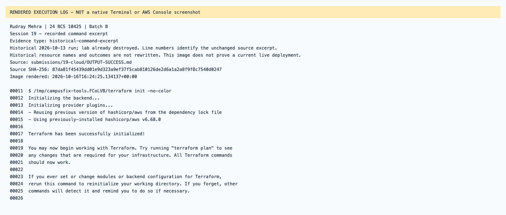
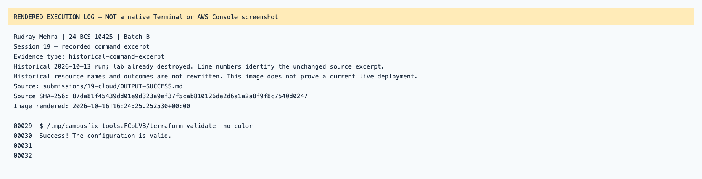
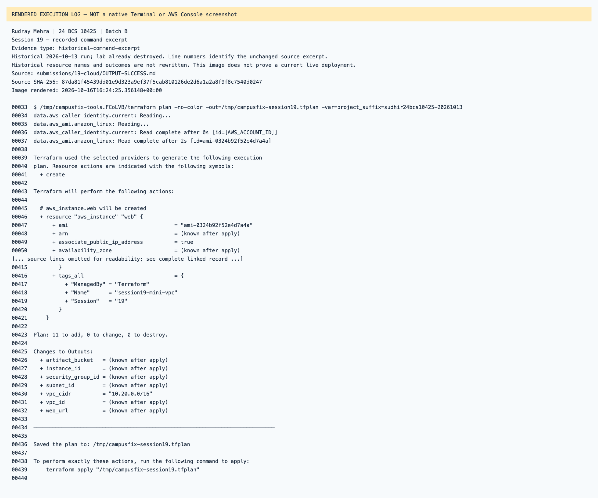
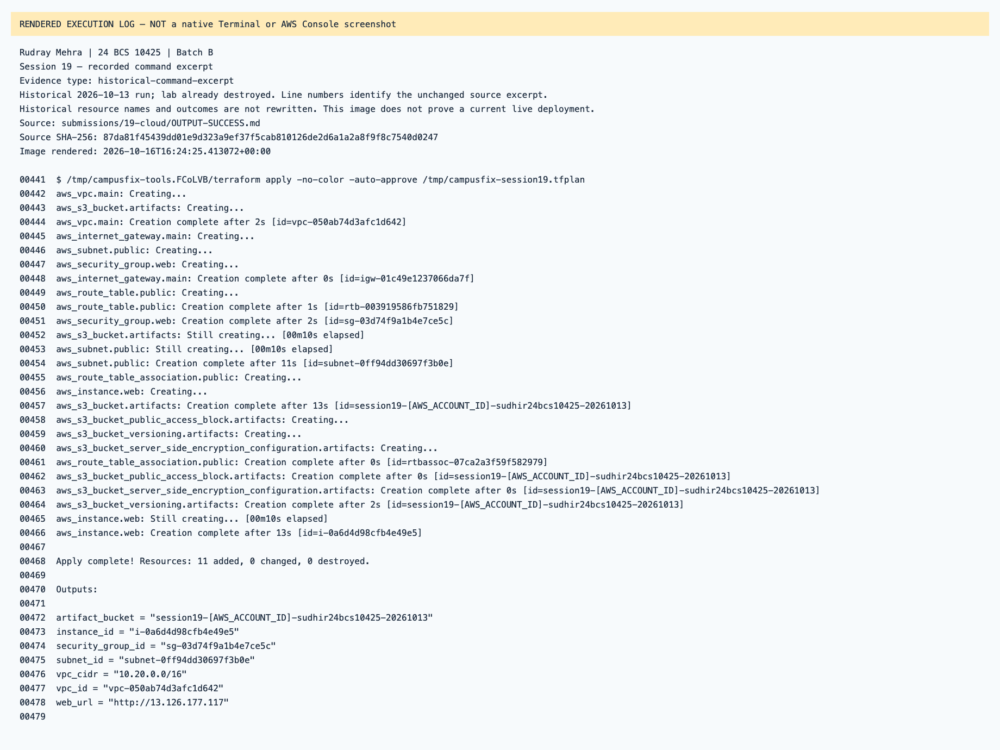
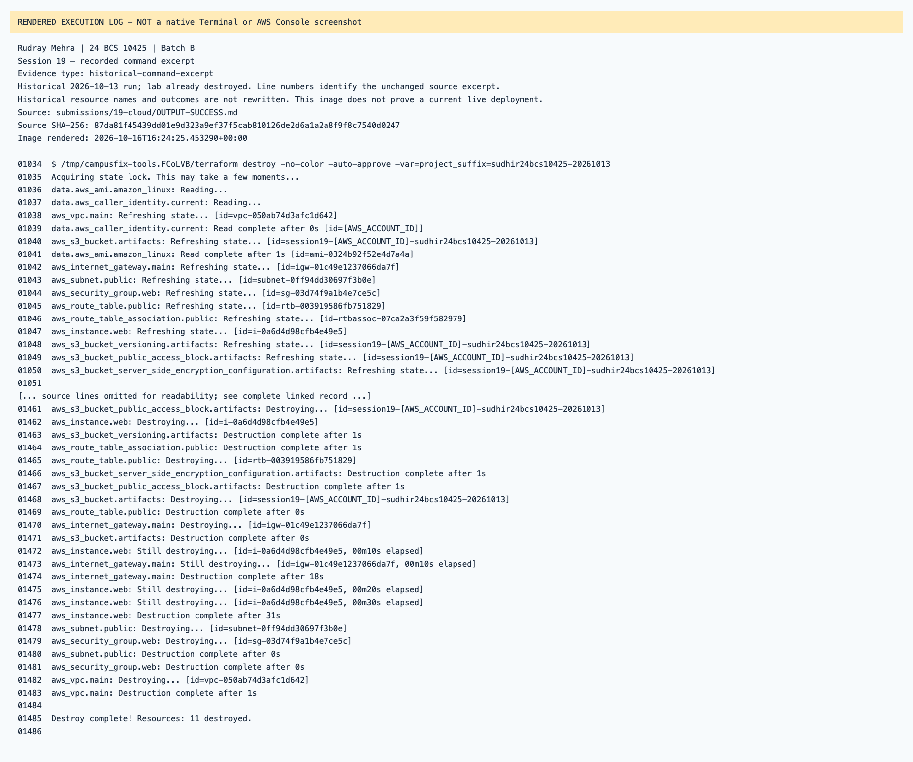
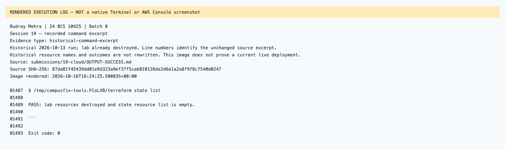

# Session 19 — rendered recorded evidence

Rudray Mehra · 24 BCS 10425 · Batch B

**Not native screenshots.** These PNGs render source-linked records. Historic resources are offline; failed attempts are not passes.
Current name in the heading identifies the submission. Old command/resource labels remain unchanged in excerpts.

## Session 19 — Terraform format check

Type: `local-recorded-command`.
[Original source](../rudray-20261016-212856-656600/01-format.txt) · [Rendered text](local-01-format.txt)

## Session 19 — actual Terraform validate (not apply)

Type: `local-recorded-command`.
[Original source](../rudray-20261016-212856-656600/02-validate.txt) · [Rendered text](local-02-validate.txt)

## Session 19 — recorded command excerpt

Type: `historical-command-excerpt`.
[Original source](../../OUTPUT-SUCCESS.md) · [Rendered text](historical-output-success-line-11.txt)

## Session 19 — recorded command excerpt

Type: `historical-command-excerpt`.
[Original source](../../OUTPUT-SUCCESS.md) · [Rendered text](historical-output-success-line-29.txt)

## Session 19 — recorded command excerpt

Type: `historical-command-excerpt`.
[Original source](../../OUTPUT-SUCCESS.md) · [Rendered text](historical-output-success-line-33.txt)

## Session 19 — recorded command excerpt

Type: `historical-command-excerpt`.
[Original source](../../OUTPUT-SUCCESS.md) · [Rendered text](historical-output-success-line-441.txt)

## Session 19 — recorded command excerpt

Type: `historical-command-excerpt`.
[Original source](../../OUTPUT-SUCCESS.md) · [Rendered text](historical-output-success-line-1034.txt)

## Session 19 — recorded command excerpt

Type: `historical-command-excerpt`.
[Original source](../../OUTPUT-SUCCESS.md) · [Rendered text](historical-output-success-line-1487.txt)

