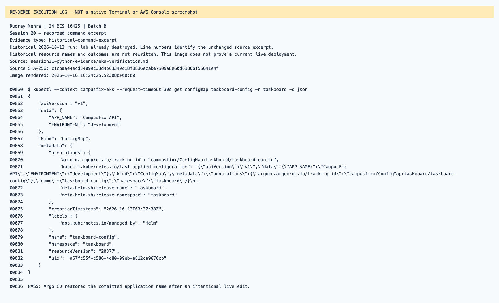
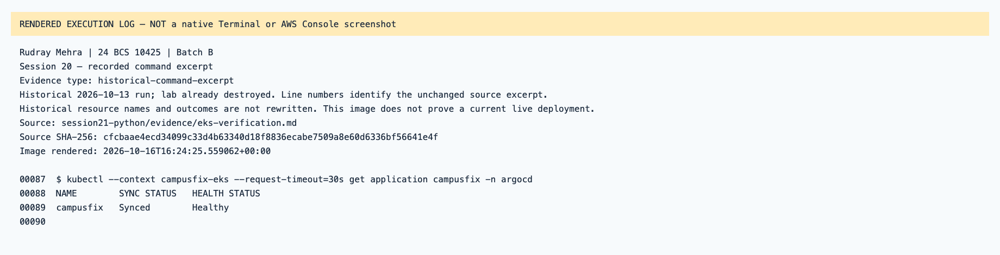
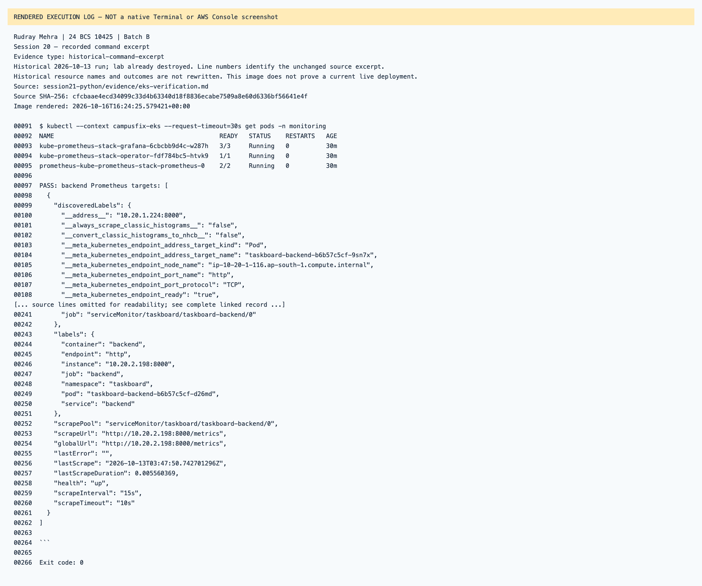
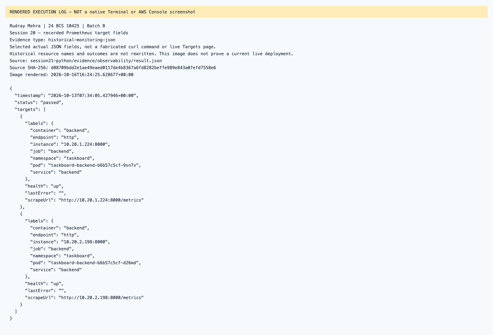

# Session 20 — rendered recorded evidence

Rudray Mehra · 24 BCS 10425 · Batch B

**Not native screenshots.** These PNGs render source-linked records. Historic resources are offline; failed attempts are not passes.
Current name in the heading identifies the submission. Old command/resource labels remain unchanged in excerpts.

## Session 20 — recorded command excerpt

Type: `historical-command-excerpt`.
[Original source](../../../../session21-python/evidence/eks-verification.md) · [Rendered text](historical-eks-verification-line-60.txt)

## Session 20 — recorded command excerpt

Type: `historical-command-excerpt`.
[Original source](../../../../session21-python/evidence/eks-verification.md) · [Rendered text](historical-eks-verification-line-87.txt)

## Session 20 — recorded command excerpt

Type: `historical-command-excerpt`.
[Original source](../../../../session21-python/evidence/eks-verification.md) · [Rendered text](historical-eks-verification-line-91.txt)

## Session 20 — recorded Prometheus target fields

Type: `historical-monitoring-json`.
[Original source](../../../../session21-python/evidence/observability/result.json) · [Rendered text](recorded-prometheus-targets.txt)

